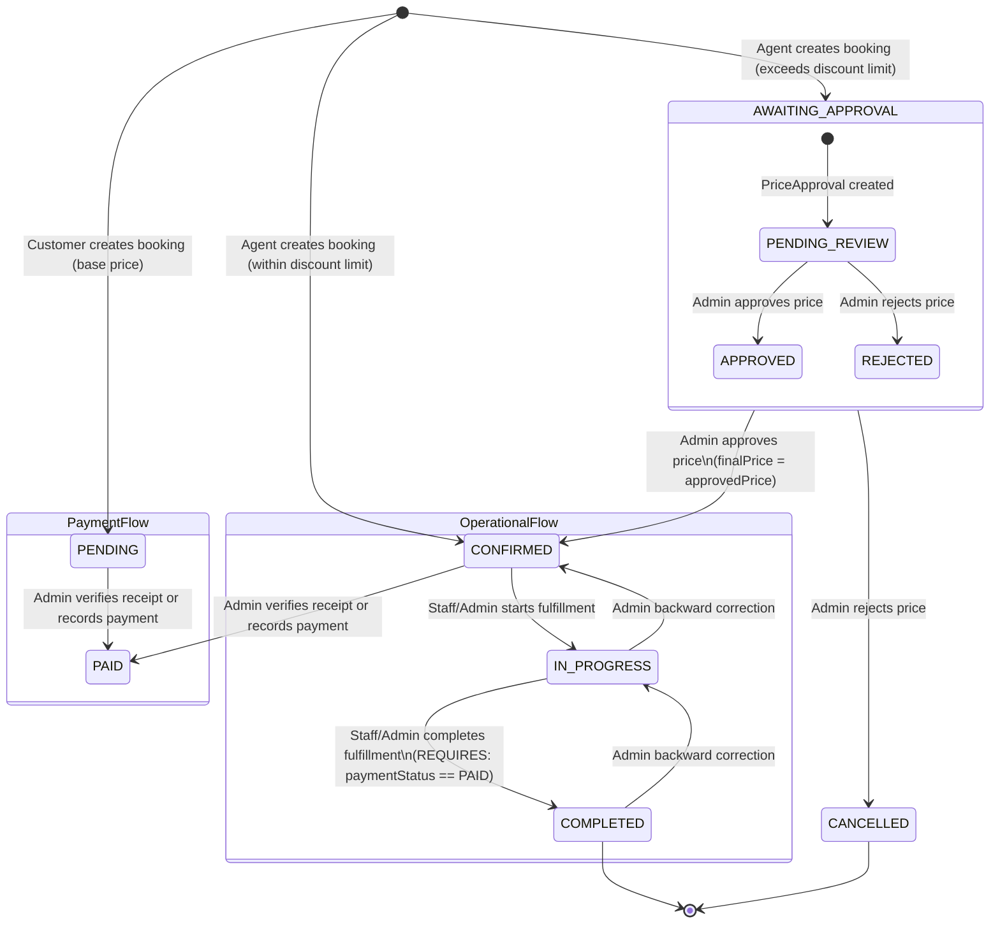

# PhuketTours — Admin Bookings Management
# Phase 1: Comprehensive Backend Audit (READ-ONLY)

> **Document Type**: Backend Architecture & API Contract Audit (Read-Only)  
> **Audited Repository**: `/home/owakeel/Workspace/Owakeel/carlsimpson/qbictravel_backend-main`  
> **Client Application**: `/home/owakeel/Workspace/Owakeel/carlsimpson/phuket-tours`  
> **Audit Status**: Complete & Verified  
> **Date**: November 1, 2026  

---

## 1. Executive Summary

This read-only audit thoroughly inspects the Prisma database schema, Express routing, controllers, services, repositories, validators, and test suites in `qbictravel_backend-main` to evaluate readiness for the **Admin Bookings Management** module.

### Key Audit Conclusions

1. **Architecture Model**: The backend implements a specialized, multi-stage booking pipeline with distinct domains:
   - **Core Booking**: `Booking`, `PriceApproval`, and `BookingHistory` in `prisma/schema/booking.prisma`.
   - **Operations & Fulfillment**: Staff assignment and status transitions (`NOT_STARTED` -> `IN_PROGRESS` -> `FULFILLED`) in `src/modules/operations/`.
   - **Payments**: Receipt verification and offline recording in `src/modules/payment/`.
   - **Commissions**: Agent commission calculation and adjustments in `src/modules/commission/`.
   - **Reporting**: Aggregated booking metrics in `src/modules/report/`.

2. **Critical Architectural Gaps for Admin Bookings**:
   - **No Master Admin Bookings List Endpoint**: The only endpoint that lists bookings is `GET /api/v1/admin/operations/bookings`, which **strictly filters** `where: { status: { in: ["CONFIRMED", "IN_PROGRESS", "COMPLETED"] } }`. Any booking with status `PENDING`, `AWAITING_APPROVAL`, `CANCELLED`, or `FAILED` is **completely invisible** in this endpoint.
   - **No Admin Booking Details Endpoint**: There is no `GET /api/v1/admin/bookings/:bookingId` or `GET /api/v1/bookings/:bookingId`. The only single-booking retrieval endpoint is `GET /api/v1/staff/operations/bookings/:bookingId`, which is restricted to `staff` and requires the booking to be assigned to that specific staff user.
   - **Availability & Capacity Disconnection**: `ServiceAvailability` has `capacity` and `bookedCount`, and `Booking` has an optional `availabilityId`. However, `bookingService.ts` **never validates availability dates**, **never checks capacity**, and **never increments `bookedCount`**.
   - **No Direct Cancellation Endpoint**: A booking can only be marked `CANCELLED` if an admin rejects an agent's price proposal (`rejectPriceApproval`). There is no endpoint for a customer, agent, or admin to cancel a confirmed or pending booking directly.
   - **Absence of Guest Counts & Multiple Services**: The database schema has no concept of guest counts (adults, children, infants), room counts, or multiple line items. 1 booking = 1 service package.

---

## 2. Database Models & Relationships

All models were verified directly in `prisma/schema/*.prisma`.

### 2.1 Model: `Booking` (`prisma/schema/booking.prisma:46-81`)

| Field Name | Type | Required / Optional | Default Value | Relation / Attributes |
| :--- | :--- | :--- | :--- | :--- |
| `id` | `String` | Required | `uuid()` | `@id @default(uuid())` |
| `customerId` | `String` | Required | — | Foreign key to `User.id` |
| `customer` | `User` | Required | — | `@relation("CustomerBookings", fields: [customerId], references: [id])` |
| `agentId` | `String?` | Optional | `null` | Foreign key to `User.id` |
| `agent` | `User?` | Optional | — | `@relation("AgentBookings", fields: [agentId], references: [id])` |
| `serviceId` | `String` | Required | — | Foreign key to `Service.id` |
| `service` | `Service` | Required | — | `@relation(fields: [serviceId], references: [id])` |
| `availabilityId` | `String?` | Optional | `null` | Foreign key to `ServiceAvailability.id` |
| `availability` | `ServiceAvailability?` | Optional | — | `@relation(fields: [availabilityId], references: [id])` |
| `basePrice` | `Decimal` | Required | — | `@db.Decimal(10, 2)` |
| `proposedPrice` | `Decimal?` | Optional | `null` | `@db.Decimal(10, 2)` |
| `finalPrice` | `Decimal` | Required | — | `@db.Decimal(10, 2)` |
| `status` | `BookingStatus` | Required | `PENDING` | Enum: `PENDING`, `CONFIRMED`, `CANCELLED`, `AWAITING_APPROVAL`, `IN_PROGRESS`, `COMPLETED`, `FAILED` |
| `requiresApproval` | `Boolean` | Required | `false` | Set to `true` when agent proposed price exceeds discount threshold |
| `paymentStatus` | `PaymentStatus` | Required | `UNPAID` | Enum: `UNPAID`, `PARTIALLY_PAID`, `PAID` |
| `fulfillmentStatus` | `FulfillmentStatus` | Required | `NOT_STARTED` | Enum: `NOT_STARTED`, `IN_PROGRESS`, `FULFILLED` |
| `notes` | `String?` | Optional | `null` | Customer / booking notes |
| `internalNotes` | `String?` | Optional | `null` | Internal administrative / staff notes |
| `assignedStaffId` | `String?` | Optional | `null` | Foreign key to `User.id` |
| `assignedStaff` | `User?` | Optional | — | `@relation("StaffAssignments", fields: [assignedStaffId], references: [id])` |
| `createdAt` | `DateTime` | Required | `now()` | `@default(now())` |
| `updatedAt` | `DateTime` | Required | — | `@updatedAt` |

#### Relationships on `Booking`
- `priceApproval`: `PriceApproval?` (1-to-1, reverse relation)
- `history`: `BookingHistory[]` (1-to-many, cascade delete)
- `payments`: `Payment[]` (1-to-many)
- `commission`: `Commission?` (1-to-1, reverse relation)

#### Indexing Analysis on `Booking`
- **Critical Finding**: There are **no custom indexes** (`@@index`) defined on `Booking`. Searching or filtering by `customerId`, `serviceId`, `agentId`, `status`, `paymentStatus`, `fulfillmentStatus`, or `createdAt` performs full table scans once volume increases.

---

### 2.2 Model: `PriceApproval` (`prisma/schema/booking.prisma:83-100`)

| Field Name | Type | Required / Optional | Default Value | Attributes |
| :--- | :--- | :--- | :--- | :--- |
| `id` | `String` | Required | `uuid()` | `@id @default(uuid())` |
| `bookingId` | `String` | Required | — | `@unique`, foreign key to `Booking.id`, `onDelete: Cascade` |
| `booking` | `Booking` | Required | — | `@relation(fields: [bookingId], references: [id], onDelete: Cascade)` |
| `requestedPrice` | `Decimal` | Required | — | `@db.Decimal(10, 2)` |
| `approvedPrice` | `Decimal?` | Optional | `null` | `@db.Decimal(10, 2)` |
| `status` | `ApprovalStatus` | Required | `PENDING` | Enum: `PENDING`, `APPROVED`, `REJECTED` |
| `adminId` | `String?` | Optional | `null` | Foreign key to `User.id` |
| `admin` | `User?` | Optional | — | `@relation("AdminApprovals", fields: [adminId], references: [id])` |
| `reviewedAt` | `DateTime?` | Optional | `null` | Timestamp of admin decision |
| `notes` | `String?` | Optional | `null` | Admin decision justification |
| `createdAt` | `DateTime` | Required | `now()` | `@default(now())` |
| `updatedAt` | `DateTime` | Required | — | `@updatedAt` |

---

### 2.3 Model: `BookingHistory` (`prisma/schema/booking.prisma:102-113`)

| Field Name | Type | Required / Optional | Default Value | Attributes |
| :--- | :--- | :--- | :--- | :--- |
| `id` | `String` | Required | `uuid()` | `@id @default(uuid())` |
| `bookingId` | `String` | Required | — | Foreign key to `Booking.id`, `onDelete: Cascade` |
| `booking` | `Booking` | Required | — | `@relation(fields: [bookingId], references: [id], onDelete: Cascade)` |
| `actorId` | `String` | Required | — | User ID who triggered the action |
| `actorRole` | `String` | Required | — | Role of actor (`customer`, `agent`, `staff`, `admin`) |
| `action` | `String` | Required | — | Event code (e.g., `OPERATIONS_STATUS_UPDATED`, `PAYMENT_VERIFIED`) |
| `changes` | `Json` | Required | — | Snapshot of previous vs new state |
| `createdAt` | `DateTime` | Required | `now()` | `@default(now())` |

- **Indexes**: `@@index([bookingId])`

---

### 2.4 Model: `Payment` (`prisma/schema/payment.prisma:14-40`)

| Field Name | Type | Required / Optional | Default Value | Attributes |
| :--- | :--- | :--- | :--- | :--- |
| `id` | `String` | Required | `uuid()` | `@id @default(uuid())` |
| `bookingId` | `String` | Required | — | Foreign key to `Booking.id` |
| `booking` | `Booking` | Required | — | `@relation(fields: [bookingId], references: [id])` |
| `customerId` | `String` | Required | — | Foreign key to `User.id` |
| `customer` | `User` | Required | — | `@relation("CustomerPayments", fields: [customerId], references: [id])` |
| `amount` | `Decimal` | Required | — | `@db.Decimal(10, 2)` |
| `method` | `PaymentMethod` | Required | — | Enum: `BANK_TRANSFER`, `CASH`, `OTHER` |
| `status` | `PaymentRecordStatus` | Required | `INITIATED` | Enum: `INITIATED`, `SUBMITTED`, `VERIFIED`, `REJECTED` |
| `reference` | `String?` | Optional | `null` | External transaction receipt reference |
| `receiptNote` | `String?` | Optional | `null` | Customer receipt note |
| `submittedAt` | `DateTime?` | Optional | `null` | When receipt was submitted |
| `receivedAt` | `DateTime?` | Optional | `null` | When payment was recorded as received |
| `reviewedById` | `String?` | Optional | `null` | Admin who verified or rejected payment |
| `reviewedBy` | `User?` | Optional | — | `@relation("PaymentReviews", fields: [reviewedById], references: [id])` |
| `reviewedAt` | `DateTime?` | Optional | `null` | Verification timestamp |
| `reviewNotes` | `String?` | Optional | `null` | Admin review notes |
| `createdAt` / `updatedAt` | `DateTime` | Required | `now()` / — | Timestamps |

- **Indexes**: `@@unique([method, reference])`, `@@index([bookingId])`, `@@index([customerId])`

---

### 2.5 Model: `Commission` (`prisma/schema/commission.prisma:22-40`)

| Field Name | Type | Required / Optional | Default Value | Attributes |
| :--- | :--- | :--- | :--- | :--- |
| `id` | `String` | Required | `uuid()` | `@id @default(uuid())` |
| `bookingId` | `String` | Required | — | `@unique`, foreign key to `Booking.id` |
| `agentId` | `String` | Required | — | Foreign key to `User.id` |
| `ruleId` | `String` | Required | — | Foreign key to `CommissionRule.id` |
| `rateType` | `CommissionRateType` | Required | — | Enum: `PERCENTAGE`, `FIXED` |
| `rateValue` | `Decimal` | Required | — | `@db.Decimal(10, 2)` |
| `baseAmount` | `Decimal` | Required | — | `@db.Decimal(10, 2)` |
| `amount` | `Decimal` | Required | — | Calculated commission amount |
| `status` | `CommissionStatus` | Required | `ACTIVE` | Enum: `ACTIVE`, `CANCELLED` |

---

### 2.6 Verified Absences in Database Schema

- **Guest Counts**: `adultCount`, `childCount`, `infantCount` are **NOT PRESENT**.
- **Booking Items / Multi-service**: `BookingItem` or relational items are **NOT PRESENT**.
- **Currency**: `currency` is present on `ServicePricing`, but **NOT PRESENT** on `Booking`.
- **Discounts & Taxes Breakdown**: `taxAmount`, `discountAmount`, `couponId` are **NOT PRESENT**.
- **Soft Deletes**: `deletedAt`, `isArchived` are **NOT PRESENT**.

---

## 3. Existing API Endpoints Audit

### 3.1 Booking Module Endpoints (`src/modules/booking/bookingRoutes.ts`)

| HTTP Method | URL Path | Role Required | Classification | Description |
| :--- | :--- | :--- | :--- | :--- |
| `POST` | `/api/v1/bookings` | `customer` | **IMPLEMENTED** | Direct customer booking creation at base price. Customer cannot negotiate price or pass `agentId`. |
| `POST` | `/api/v1/agent/bookings` | `agent` | **IMPLEMENTED** | Agent booking with negotiated `proposedPrice`. Auto-confirms if within limits; sets `AWAITING_APPROVAL` if outside. |
| `PATCH` | `/api/v1/agent/bookings/:bookingId/price` | `agent` | **IMPLEMENTED** | Update proposed price while booking is unconfirmed/unpaid. |
| `POST` | `/api/v1/admin/bookings/:bookingId/price-approvals` | `admin` | **IMPLEMENTED** | Admin approves or rejects proposed price. Approving sets `CONFIRMED`; rejecting sets `CANCELLED`. |

---

### 3.2 Operations Module Endpoints (`src/modules/operations/operationsRoutes.ts`)

| HTTP Method | URL Path | Role Required | Classification | Description |
| :--- | :--- | :--- | :--- | :--- |
| `GET` | `/api/v1/admin/operations/bookings` | `admin` | **PARTIALLY IMPLEMENTED** | Lists operational bookings. **Critical limit**: Only returns bookings where `status IN ("CONFIRMED", "IN_PROGRESS", "COMPLETED")`. Excludes `PENDING`, `AWAITING_APPROVAL`, `CANCELLED`, `FAILED`. |
| `PATCH` | `/api/v1/admin/operations/bookings/:bookingId/assignment` | `admin` | **IMPLEMENTED** | Assign or unassign a staff member (`staffId: uuid \| null`). |
| `PATCH` | `/api/v1/admin/operations/bookings/:bookingId/status` | `admin` | **IMPLEMENTED** | Advance or correct fulfillment status (`NOT_STARTED`, `IN_PROGRESS`, `FULFILLED`). |
| `GET` | `/api/v1/staff/operations/bookings` | `staff` | **IMPLEMENTED** | Queue of bookings assigned to calling staff member. |
| `GET` | `/api/v1/staff/operations/bookings/:bookingId` | `staff` | **IMPLEMENTED** | View operational details of assigned booking. |
| `PATCH` | `/api/v1/staff/operations/bookings/:bookingId/status` | `staff` | **IMPLEMENTED** | Forward fulfillment transition (`NOT_STARTED` -> `IN_PROGRESS` -> `FULFILLED`). |

---

### 3.3 Payment Module Endpoints (`src/modules/payment/paymentRoutes.ts`)

| HTTP Method | URL Path | Role Required | Classification | Description |
| :--- | :--- | :--- | :--- | :--- |
| `POST` | `/api/v1/bookings/:bookingId/payments` | `customer` | **IMPLEMENTED** | Initiate payment or submit receipt reference. |
| `GET` | `/api/v1/customer/payments` | `customer` | **IMPLEMENTED** | Customer views own payment history. |
| `GET` | `/api/v1/customer/payments/:paymentId` | `customer` | **IMPLEMENTED** | Customer views single payment. |
| `GET` | `/api/v1/agent/payments` | `agent` | **IMPLEMENTED** | Agent views payments for own bookings. |
| `GET` | `/api/v1/admin/payments` | `admin` | **IMPLEMENTED** | Admin lists platform payments (filters: `status`, `method`, `bookingId`, `customerId`). |
| `GET` | `/api/v1/admin/payments/:paymentId` | `admin` | **IMPLEMENTED** | Admin views payment details. |
| `POST` | `/api/v1/admin/payments/:paymentId/verify` | `admin` | **IMPLEMENTED** | Admin marks submitted payment `VERIFIED` or `REJECTED`. |
| `POST` | `/api/v1/admin/payments/:paymentId/record` | `admin` | **IMPLEMENTED** | Admin records offline payment as `VERIFIED`. |

---

### 3.4 Report Module Endpoints (`src/modules/report/reportRoutes.ts`)

| HTTP Method | URL Path | Role Required | Classification | Description |
| :--- | :--- | :--- | :--- | :--- |
| `GET` | `/api/v1/admin/reports/bookings` | `admin` | **IMPLEMENTED** | Aggregated booking volume grouped by status over date range. |
| `GET` | `/api/v1/admin/reports/revenue` | `admin` | **IMPLEMENTED** | Revenue, booked value, and outstanding balance summary. |
| `GET` | `/api/v1/admin/reports/payments` | `admin` | **IMPLEMENTED** | Payments status summary and reconciliation. |
| `GET` | `/api/v1/admin/reports/services` | `admin` | **IMPLEMENTED** | Booking volume breakdown by service. |

---

### 3.5 Detailed Operation Support Checklist

| Required Admin Operation | Backend Support Status | Implementation Reference / Reason |
| :--- | :--- | :--- |
| **List All Bookings** | **NOT IMPLEMENTED** | `GET /api/v1/admin/operations/bookings` exists but hardcodes `status IN ("CONFIRMED", "IN_PROGRESS", "COMPLETED")`. No endpoint lists `PENDING`, `AWAITING_APPROVAL`, or `CANCELLED` bookings. |
| **View Booking Details** | **NOT IMPLEMENTED** | `GET /api/v1/staff/operations/bookings/:bookingId` exists but requires `staff` role and assignment. No admin endpoint exists. |
| **Search Bookings (Name/Email/ID)** | **NOT IMPLEMENTED** | No search parameter is parsed or supported in any booking query. |
| **Filter by Booking Status** | **NOT IMPLEMENTED** | `status` filter is rejected or ignored. Only `fulfillmentStatus` is supported on operational bookings. |
| **Filter by Payment Status** | **NOT IMPLEMENTED** | Supported on `/api/v1/admin/payments`, but not on bookings list. |
| **Filter by Tour / Service** | **NOT IMPLEMENTED** | Not supported in query parameters. |
| **Filter by Booking Date** | **NOT IMPLEMENTED** | Not supported in query parameters. |
| **Filter by Customer** | **NOT IMPLEMENTED** | Not supported in query parameters. |
| **Dynamic Sorting** | **NOT IMPLEMENTED** | Hardcoded to `orderBy: { createdAt: "desc" }`. |
| **Server-Side Pagination** | **PARTIALLY IMPLEMENTED** | Implemented on operations (`page`, `limit`), but only for operational subset. |
| **Update Booking Status** | **PARTIALLY IMPLEMENTED** | Only indirect via price approval review or operations fulfillment transition. |
| **Confirm Booking** | **PARTIALLY IMPLEMENTED** | Auto-confirmed by payment verification or price approval; no manual trigger. |
| **Cancel Booking** | **NOT IMPLEMENTED** | Only price proposal rejection sets `CANCELLED`. No standalone cancel endpoint. |
| **Reschedule Booking** | **NOT IMPLEMENTED** | No endpoint to update dates or `availabilityId`. |
| **Update Guest Information** | **NOT IMPLEMENTED** | Guest fields do not exist in the database schema. |
| **Update Internal Notes** | **NOT IMPLEMENTED** | `Booking.internalNotes` exists in DB, but no endpoint allows direct editing. |
| **Refund Management** | **NOT IMPLEMENTED** | No refund status, model, or endpoint exists. |
| **Export Booking Records** | **NOT IMPLEMENTED** | No export endpoint exists. |
| **Bulk Operations** | **NOT IMPLEMENTED** | No bulk endpoints exist. |

---

## 4. Booking Lifecycle & Status Workflow



### Status Differentiation

1. **`BookingStatus`** (Core lifecycle):
   - `PENDING`: Created by customer at base price, awaiting payment.
   - `AWAITING_APPROVAL`: Created by agent with proposed discount, awaiting admin review.
   - `CONFIRMED`: Price agreed (customer base price, agent approved price, or agent auto-approved price).
   - `IN_PROGRESS`: Operational delivery has commenced (`fulfillmentStatus = IN_PROGRESS`).
   - `COMPLETED`: Operational delivery finished (`fulfillmentStatus = FULFILLED`) AND payment is `PAID`.
   - `CANCELLED`: Admin rejected agent price proposal.
   - `FAILED`: Unused in business logic (defined in enum only).

2. **`PaymentStatus`** (Monetary settlement):
   - `UNPAID`: Default state at creation.
   - `PARTIALLY_PAID`: Defined in enum, but unused in application logic.
   - `PAID`: Triggered when an admin verifies a receipt (`verifyPayment`) or records offline funds (`recordPayment`).

3. **`FulfillmentStatus`** (Operational execution):
   - `NOT_STARTED`: Default state at creation.
   - `IN_PROGRESS`: Delivery started by staff/admin.
   - `FULFILLED`: Tour completed. Transition is blocked by business rule unless `paymentStatus === "PAID"`.

---

## 5. Business Logic & Validation Rules

1. **Price Negotiation Rules (`src/modules/booking/bookingService.ts:80-107`)**:
   - Customers **cannot negotiate price** (`proposedPrice` throws HTTP 403).
   - Customers **cannot assign an agent** (`agentId` throws HTTP 403).
   - Customers can **only book for themselves** (`customerId === req.user.id`).
   - Agents **must provide `proposedPrice`**.
   - Minimum allowed price is calculated via:
     $$\text{minAllowedPrice} = \text{basePrice} \times \left(1 - \frac{\text{maxDiscountPercentage}}{100}\right)$$
   - If $\text{proposedPrice} < \text{minAllowedPrice}$, `requiresApproval = true` and `status = AWAITING_APPROVAL`.

2. **Price Approval Rules (`src/modules/booking/bookingService.ts:219-253`)**:
   - Only bookings with `status === "AWAITING_APPROVAL"` and `requiresApproval === true` can be reviewed.
   - Approval requires `approvedPrice` to be specified.
   - Rejection sets `status = CANCELLED` and `priceApproval.status = REJECTED`.

3. **Fulfillment Completion Guard (`src/modules/operations/operationsService.ts:89-91`)**:
   - Moving from `IN_PROGRESS` to `FULFILLED` strictly requires `paymentStatus === "PAID"`. If unpaid, throws HTTP 409: `"Payment must be verified before the booking can be completed"`.

4. **Backward Operational Corrections (`src/modules/operations/operationsService.ts:81-83`)**:
   - Only an `admin` can revert `IN_PROGRESS` -> `NOT_STARTED` or `FULFILLED` -> `IN_PROGRESS`. Staff cannot revert states.

5. **Commission Calculation Trigger (`src/modules/payment/paymentRepository.ts:166`)**:
   - Commission for an agent is generated **only when payment transitions to `VERIFIED`**.
   - If the booking has no `agentId`, no commission record is created.

---

## 6. Authentication & Security Findings

| Finding ID | Severity | Area | Code Reference | Description |
| :--- | :--- | :--- | :--- | :--- |
| **SEC-01** | **Medium** | Concurrency / Race Condition | `bookingService.ts:109-120` | `createBooking` executes outside a database transaction. If the server fails after creating the booking but before creating the `PriceApproval`, the booking remains orphaned in `AWAITING_APPROVAL` with no approval record. |
| **SEC-02** | **Medium** | Availability Bypass | `bookingService.ts:53-128` | Bookings can be created with any arbitrary `availabilityId` or no availability. The backend never validates whether the date is available or if capacity is exceeded. Overbooking is completely unchecked. |
| **SEC-03** | **Low** | Missing Indexing | `prisma/schema/booking.prisma:46` | The `Booking` table lacks indexes on `customerId`, `serviceId`, `agentId`, `status`, and `createdAt`. This will cause performance degradation as table size increases. |
| **SEC-04** | **Low** | Absence of Direct Cancellation | `bookingService.ts` | Once created, a customer or agent has zero ability to cancel a booking. Admins have no endpoint to cancel a confirmed booking. |
| **SEC-05** | **Low** | Customer PII in Operations | `operationsRepository.ts:21` | Staff members can see customer phone numbers and full names for assigned bookings. This is expected operationally, but no audit log tracks staff viewing PII. |

---

## 7. Integration Audit

1. **Users / Customers (`src/modules/user`)**: **IMPLEMENTED**.
   - Validates that customer exists and has `status === "active"`.
2. **Tours / Services (`src/modules/service`)**: **PARTIALLY IMPLEMENTED**.
   - Verifies `serviceId` exists and active pricing is found.
   - Does not pull or snapshot tour title, duration, destination, or thumbnail into the booking.
3. **ServicePricing (`src/modules/pricing`)**: **PARTIALLY IMPLEMENTED**.
   - Pulls `basePrice`. Ignores `currency`, `taxRate`, `discountedPrice`, and seasonal tiers.
4. **ServiceAvailability (`src/modules/service`)**: **NOT IMPLEMENTED**.
   - `availabilityId` is stored as an unvalidated UUID foreign key. No date range or capacity validation occurs.
5. **Payments (`src/modules/payment`)**: **PARTIALLY IMPLEMENTED**.
   - Payments can be created, receipts submitted, verified, and recorded. No online gateway, partial payments, or refunds.
6. **Notifications / Mailer (`src/modules/notification`)**: **IMPLEMENTED**.
   - Triggers automated emails on booking creation, status change, payment verification, and operational updates.
7. **Agents & Commissions (`src/modules/commission`)**: **IMPLEMENTED**.
   - Enforces agent discount rules and computes commission upon payment verification.

---

## 8. Existing Tests & Reliability

All 31 test suites (604 unit and integration tests) pass in `qbictravel_backend-main`.

### Booking-Specific Test Coverage

1. `src/modules/booking/tests/integration/booking.test.ts` (6 tests):
   - `POST /api/v1/bookings` (Customer creates booking at base price).
   - `POST /api/v1/agent/bookings` (Agent creates booking requiring approval).
   - `PATCH /api/v1/agent/bookings/:bookingId/price` (Agent updates price).
   - `POST /api/v1/admin/bookings/:bookingId/price-approvals` (Admin approves price).
2. `src/modules/booking/tests/unit/bookingService.guards.test.ts` (3 tests):
   - Validates that customer cannot book for another user.
   - Validates that customer cannot provide `agentId`.
   - Validates that agent cannot book for inactive/nonexistent customer.
3. `src/modules/booking/tests/unit/bookingService.test.ts` (7 tests):
   - Customer negotiation forbidden.
   - Agent auto-approval threshold enforcement.
   - Price approval requirement logic.
4. `src/modules/operations/tests/integration/operations.test.ts` (31 tests):
   - Operational queue listing and transitions.
   - Staff assignment and unassignment.
   - Paid payment requirement for completion.

---

## 9. Frontend Integration Contracts

### 9.1 Existing Usable Endpoints for Admin

#### A. Review Operational Bookings Queue
- **Method**: `GET`
- **URL**: `/api/v1/admin/operations/bookings`
- **Auth**: `Bearer <token>` or `cookie: token` (Role: `admin`)
- **Query Params**:
  - `page?: number` (default: 1)
  - `limit?: number` (default: 10)
  - `fulfillmentStatus?: "NOT_STARTED" | "IN_PROGRESS" | "FULFILLED"`
  - `assignedStaffId?: string (UUID)`
- **Response Structure (200 OK)**:
```json
{
  "success": true,
  "message": "Operational bookings retrieved successfully",
  "data": {
    "items": [
      {
        "id": "uuid",
        "status": "CONFIRMED",
        "fulfillmentStatus": "NOT_STARTED",
        "paymentStatus": "UNPAID",
        "assignedStaffId": null,
        "notes": "Customer notes",
        "internalNotes": null,
        "createdAt": "2026-11-01T10:00:00.000Z",
        "updatedAt": "2026-11-01T10:00:00.000Z",
        "service": {
          "id": "uuid",
          "name": "Phi Phi Islands Tour",
          "type": "TOUR"
        },
        "availability": {
          "id": "uuid",
          "date": "2026-11-15T00:00:00.000Z"
        },
        "customer": {
          "id": "uuid",
          "name": "John Doe",
          "phone": "+66 81 234 5678"
        },
        "assignedStaff": null
      }
    ],
    "page": 1,
    "limit": 10,
    "total": 1
  }
}
```

#### B. Assign Staff Member to Booking
- **Method**: `PATCH`
- **URL**: `/api/v1/admin/operations/bookings/:bookingId/assignment`
- **Auth**: `Bearer <token>` (Role: `admin`)
- **Request Body**:
```json
{
  "staffId": "uuid | null",
  "notes": "Optional assignment notes"
}
```
- **Response Structure (200 OK)**: Returns updated operational booking object.

#### C. Update Fulfillment Status
- **Method**: `PATCH`
- **URL**: `/api/v1/admin/operations/bookings/:bookingId/status`
- **Auth**: `Bearer <token>` (Role: `admin`)
- **Request Body**:
```json
{
  "fulfillmentStatus": "NOT_STARTED | IN_PROGRESS | FULFILLED",
  "notes": "Justification for status change"
}
```
- **Response Structure (200 OK)**: Returns updated operational booking object.

#### D. Review Agent Price Approval
- **Method**: `POST`
- **URL**: `/api/v1/admin/bookings/:bookingId/price-approvals`
- **Auth**: `Bearer <token>` (Role: `admin`)
- **Request Body**:
```json
{
  "status": "APPROVED | REJECTED",
  "approvedPrice": 85.00,
  "notes": "Approved for promotional group"
}
```
- **Response Structure (200 OK)**: Returns updated booking with price approval.

#### E. View and Verify Platform Payments
- **Method**: `GET /api/v1/admin/payments` & `POST /api/v1/admin/payments/:paymentId/verify`
- **Auth**: `Bearer <token>` (Role: `admin`)
- **Verify Request Body**:
```json
{
  "decision": "VERIFIED | REJECTED",
  "notes": "Required if rejected"
}
```

---

## 10. Missing Backend Capabilities Summary

To build an enterprise-grade Admin Bookings Management interface, the following capabilities are currently **missing from the backend**:

| Missing Feature | Description | Workaround / Current State |
| :--- | :--- | :--- |
| **All-Status Bookings List** | Endpoint to list bookings across all statuses (`PENDING`, `AWAITING_APPROVAL`, `CANCELLED`). | The UI can currently only list operational bookings (`CONFIRMED`, `IN_PROGRESS`, `COMPLETED`). |
| **Admin Booking Detail** | Endpoint for admin to view full booking details including pricing, customer email, payments, and history. | Admin must view partial fields from operations or cross-reference payments. |
| **Search & Advanced Filters** | Filtering by customer name, tour name, date range, or booking status. | The existing operational endpoint only filters by `fulfillmentStatus` and `assignedStaffId`. |
| **Direct Cancellation** | Ability for admin to cancel a booking directly with a reason. | Cancellation only occurs when rejecting an agent price proposal. |
| **Guest Counts** | Ability to record or display number of adults, children, and infants. | Completely unsupported in backend models and APIs. |
| **Direct Notes Editing** | Ability to edit `internalNotes` on a booking. | Currently only written to `BookingHistory.changes` during state transitions. |

---

## 11. Recommendations for Phase 2 (Frontend Architecture)

1. **Leverage Existing Operations & Payment APIs**:
   - The Admin Bookings interface should integrate with `GET /api/v1/admin/operations/bookings` for operational management, staff assignments, and fulfillment progress.
   - Price negotiation approvals should integrate directly with `POST /api/v1/admin/bookings/:bookingId/price-approvals`.
   - Payment tracking and receipt verifications should integrate with `GET /api/v1/admin/payments` and `POST /api/v1/admin/payments/:paymentId/verify`.
2. **Clearly Communicate Filter Limitations**:
   - The UI must reflect that `PENDING` and `AWAITING_APPROVAL` bookings are not returned in the general operational queue.
3. **Preserve Read-Only Backend Integrity**:
   - In accordance with project rules, do not invent client-side data or attempt to write unsupported fields (such as guest counts or fake cancel endpoints) to the backend.
