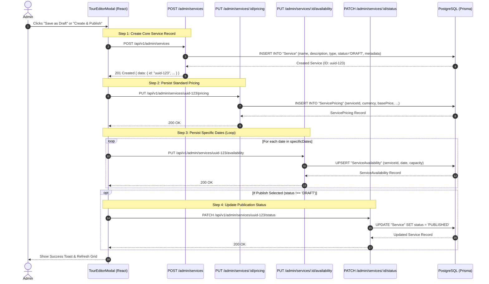
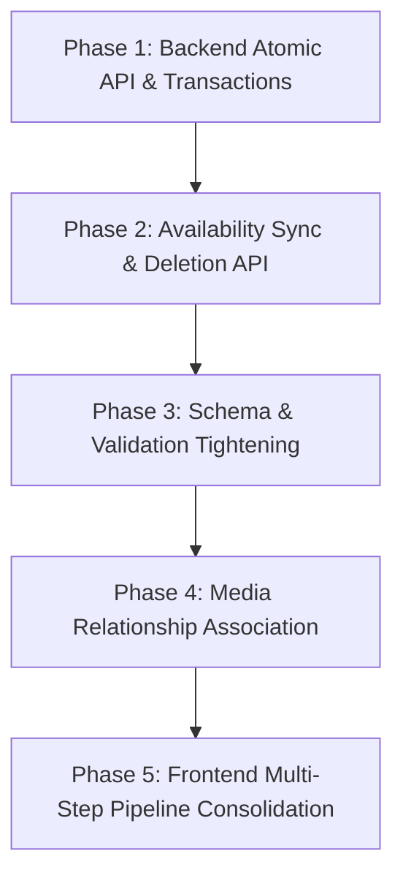

# PhuketTours — Create New Tour Package: Frontend vs Backend Contract Audit

**Document Version:** 1.0.0  
**Audit Date:** November 1, 2026  
**Auditor:** Senior Principal Full-Stack & Systems Architecture Engineer (Antigravity)  
**Scope:** Read-Only Contract & Persistence Verification of Admin "Create New Tour Package" Workflow  
**Frontend Path:** `/home/owakeel/Workspace/Owakeel/carlsimpson/phuket-tours`  
**Backend Path:** `/home/owakeel/Workspace/Owakeel/carlsimpson/qbictravel_backend-main`  

---

## Executive Summary

This document presents a comprehensive, read-only architectural audit comparing the **Admin "Create New Tour Package"** frontend workflow against the backend API contracts, Zod validation schemas, Prisma ORM models, and PostgreSQL persistence layer.

### Core Audit Finding

The frontend form and the backend **do not operate on a 1:1 relational schema**. Instead, the system functions under a **hybrid relational-document architecture**:
1. **Core Identity & Status:** Persisted directly into relational columns of the `Service` table (`id`, `name`, `description`, `type`, `status`, `providerName`, `providerId`).
2. **Pricing (Standard Base Rates):** Persisted into relational columns of the `ServicePricing` table via a secondary API call (`PUT /admin/services/:id/pricing`).
3. **Availability (Calendar Dates):** Persisted into relational columns of the `ServiceAvailability` table via sequential API calls (`PUT /admin/services/:id/availability`).
4. **Tour Domain Attributes (Itinerary, Tiers, Schedule, Media, Metadata):** Persisted into the PostgreSQL `metadata` (`JSONB`) column of the `Service` record.

While the frontend form collects and submits substantial rich data that successfully saves into PostgreSQL via the `metadata` JSONB column, **the creation workflow is currently non-atomic, requires 4+ sequential HTTP requests, lacks date deletion capabilities, does not enforce slug uniqueness, and does not link media asset records to the service foreign key**.

---

## Table of Contents

- [Section A — Overall Assessment](#section-a--overall-assessment)
- [Section B — Field-by-Field Mapping Matrix](#section-b--field-by-field-mapping-matrix)
  - [Step 1: Basic Info](#step-1-basic-info)
  - [Step 2: Pricing & Packages](#step-2-pricing--packages)
  - [Step 3: Itinerary Timeline](#step-3-itinerary-timeline)
  - [Step 4: Schedule & Dates](#step-4-schedule--dates)
  - [Step 5: Photos & Gallery](#step-5-photos--gallery)
- [Section C — API Contract Analysis](#section-c--api-contract-analysis)
  - [1. Tour Creation Pipeline (Multi-Request Chain)](#1-tour-creation-pipeline-multi-request-chain)
  - [2. Tour Update Pipeline](#2-tour-update-pipeline)
  - [3. Tour Retrieval Contract (`GET /admin/services/:id`)](#3-tour-retrieval-contract-get-adminservicesid)
- [Section D — Database Persistence & Schema Mapping](#section-d--database-persistence--schema-mapping)
  - [Prisma Relational Models](#prisma-relational-models)
  - [JSONB Metadata Schema](#jsonb-metadata-schema)
- [Section E — Missing Capabilities & Architectural Gaps](#section-e--missing-capabilities--architectural-gaps)
- [Section F — Risk Assessment](#section-f--risk-assessment)
- [Section G — Recommended Implementation Order](#section-g--recommended-implementation-order)

---

## Section A — Overall Assessment

### Is the Frontend Fully Supported by the Backend?

**Verdict: PARTIALLY SUPPORTED (Hybrid Architecture with Critical Workflow Gaps)**

| Architectural Layer | Support Level | Summary |
| :--- | :--- | :--- |
| **Basic Information (Step 1)** | **FULLY SUPPORTED** | Core fields map to `Service` columns; tour-specific fields (slug, destination, duration, badge, languages) persist in `Service.metadata` JSONB. Backend repository explicitly indexes and searches `metadata->>'destination'`, `metadata->>'destinationCategory'`, and `metadata->'location'->>'city'`. |
| **Pricing & Packages (Step 2)** | **PARTIALLY SUPPORTED** | Base pricing (`currency`, `basePrice`, `discountedPrice`, `taxRate`) maps directly to the relational `ServicePricing` table. Custom pricing tiers (Adult, Child, Infant, Custom Tiers) and inclusions/exclusions persist in `Service.metadata.pricingTiers` (JSONB) with no relational validation. |
| **Itinerary Timeline (Step 3)** | **PARTIALLY SUPPORTED** | Persists completely in `Service.metadata.itinerary` (JSONB). There is no relational `Itinerary` table or dedicated itinerary API endpoint in the backend. |
| **Schedule & Dates (Step 4)** | **PARTIALLY SUPPORTED** | Specific calendar dates persist in the relational `ServiceAvailability` table. However, operating hours, daily toggles, days of week, and time slots are stored in `metadata.scheduleDetails`. Crucially, **there is no API endpoint to delete availability dates** when removed in the UI. |
| **Photos & Gallery (Step 5)** | **PARTIALLY SUPPORTED** | Image URLs persist in `Service.metadata.featuredImage` and `metadata.images`. However, the relational foreign key `Media.serviceId` is never linked or updated when saving a tour. |
| **Save / Publish Workflow** | **HIGH RISK / FRAGILE** | The frontend executes a non-atomic chain of up to 4+ separate network requests. A failure midway leaves partial or orphaned records. |

### Technical Verification Summary

1. **Frontend Implementation:**
   - Managed in [`tour-editor-modal.tsx`](file:///home/owakeel/Workspace/Owakeel/carlsimpson/phuket-tours/src/features/admin/components/tours/tour-editor-modal.tsx).
   - Composed of 5 tab views: [`BasicInfoTab`](file:///home/owakeel/Workspace/Owakeel/carlsimpson/phuket-tours/src/features/admin/components/tours/tour-editor/basic-info-tab.tsx), [`PricingTab`](file:///home/owakeel/Workspace/Owakeel/carlsimpson/phuket-tours/src/features/admin/components/tours/tour-editor/pricing-tab.tsx), [`ItineraryTab`](file:///home/owakeel/Workspace/Owakeel/carlsimpson/phuket-tours/src/features/admin/components/tours/tour-editor/itinerary-tab.tsx), [`AvailabilityTab`](file:///home/owakeel/Workspace/Owakeel/carlsimpson/phuket-tours/src/features/admin/components/tours/tour-editor/availability-tab.tsx), and [`MediaTab`](file:///home/owakeel/Workspace/Owakeel/carlsimpson/phuket-tours/src/features/admin/components/tours/tour-editor/media-tab.tsx).
   - Data types defined in [`admin-services.ts`](file:///home/owakeel/Workspace/Owakeel/carlsimpson/phuket-tours/src/features/admin/types/admin-services.ts).
   - API client methods defined in [`admin-api.ts`](file:///home/owakeel/Workspace/Owakeel/carlsimpson/phuket-tours/src/features/admin/api/admin-api.ts).

2. **Backend Implementation:**
   - Routes: [`serviceRoutes.ts`](file:///home/owakeel/Workspace/Owakeel/carlsimpson/qbictravel_backend-main/src/modules/service/serviceRoutes.ts).
   - Validators: [`serviceValidators.ts`](file:///home/owakeel/Workspace/Owakeel/carlsimpson/qbictravel_backend-main/src/modules/service/serviceValidators.ts) using Zod.
   - Controllers: [`serviceController.ts`](file:///home/owakeel/Workspace/Owakeel/carlsimpson/qbictravel_backend-main/src/modules/service/serviceController.ts).
   - Services: [`serviceService.ts`](file:///home/owakeel/Workspace/Owakeel/carlsimpson/qbictravel_backend-main/src/modules/service/serviceService.ts).
   - Repositories: [`serviceRepository.ts`](file:///home/owakeel/Workspace/Owakeel/carlsimpson/qbictravel_backend-main/src/modules/service/serviceRepository.ts).
   - Database Schema: [`service.prisma`](file:///home/owakeel/Workspace/Owakeel/carlsimpson/qbictravel_backend-main/prisma/schema/service.prisma) and [`media.prisma`](file:///home/owakeel/Workspace/Owakeel/carlsimpson/qbictravel_backend-main/prisma/schema/media.prisma).

---

## Section B — Field-by-Field Mapping Matrix

**Status Key:**
- **FULLY SUPPORTED:** Field is collected, transmitted, accepted by validation, and persisted in a dedicated relational column or explicitly indexed/handled JSONB property.
- **PARTIALLY SUPPORTED:** Field persists in PostgreSQL JSONB `metadata`, but lacks relational constraints, dedicated validation, or relational foreign keys.
- **FRONTEND ONLY:** Field is collected in the frontend UI but ignored, dropped, or unpersisted by the backend.
- **BACKEND ONLY:** Field exists in backend models or validation but is absent from the frontend form.
- **NOT IMPLEMENTED:** Expected workflow operation or endpoint is missing from the system.
- **NEEDS VERIFICATION:** Field behavior depends on runtime edge cases or external services.

---

### Step 1: Basic Info

| Field Name | Frontend Input / State | Required / Optional | Backend Destination | DB Storage Type | Status | Audit Findings & Notes |
| :--- | :--- | :--- | :--- | :--- | :--- | :--- |
| **Tour Title** | Input (`formData.name`) | **Required** | `Service.name` | `VARCHAR(255)` | **FULLY SUPPORTED** | Validated by Zod (`z.string().min(2).max(255)`). Mapped to primary column. |
| **URL Slug** | Input (`formData.metadata.slug`) | Optional / Auto-gen | `Service.metadata.slug` | `JSONB` | **PARTIALLY SUPPORTED** | Persisted in JSONB. **No unique constraint** in DB; no collision prevention endpoint exists. |
| **Subtitle / Hook** | Input (`formData.metadata.subtitle`) | Optional | `Service.metadata.subtitle` | `JSONB` | **FULLY SUPPORTED** | Persisted in JSONB metadata. Returned by GET endpoints. |
| **Full Description**| Textarea (`formData.description`) | **Required** | `Service.description` | `TEXT` | **FULLY SUPPORTED** | Validated by Zod (`z.string().min(10)`). Mapped to primary column. |
| **Primary Destination** | Select (`formData.metadata.destination`) | **Required** | `Service.metadata.destination` | `JSONB` | **FULLY SUPPORTED** | Stored in JSONB. Explicitly indexed and queried in `serviceRepository.ts` via `metadata->>'destination'`. |
| **Destination Category**| Select (`formData.metadata.destinationCategory`) | Optional | `Service.metadata.destinationCategory` | `JSONB` | **FULLY SUPPORTED** | Stored in JSONB. Explicitly searched in `serviceRepository.ts` via `metadata->>'destinationCategory'`. |
| **Departure Point / Pier** | Input (`formData.metadata.location.address`) | Optional | `Service.metadata.location.address` | `JSONB` | **FULLY SUPPORTED** | Stored inside `location` object in `metadata`. |
| **Operating City / Prov.**| Input (`formData.metadata.location.city`) | Optional | `Service.metadata.location.city` | `JSONB` | **FULLY SUPPORTED** | Stored in JSONB. Explicitly queried in fuzzy search via `metadata->'location'->>'city'`. |
| **Country** | Input (`formData.metadata.location.country`) | Optional (Default 'Thailand') | `Service.metadata.location.country` | `JSONB` | **FULLY SUPPORTED** | Stored in JSONB `location.country`. |
| **Duration Label** | Input (`formData.metadata.duration`) | Optional | `Service.metadata.duration` | `JSONB` | **FULLY SUPPORTED** | Stored in JSONB (e.g. `"7-8 Hours"`). |
| **Duration Category** | Select (`formData.metadata.durationCategory`) | Optional | `Service.metadata.durationCategory` | `JSONB` | **FULLY SUPPORTED** | Stored in JSONB (e.g. `'FULL_DAY'`, `'HALF_DAY'`). |
| **Tour Category / Type** | Select (`formData.metadata.tourType`) | Optional | `Service.metadata.tourType` | `JSONB` | **FULLY SUPPORTED** | Stored in JSONB (e.g. `'SPEEDBOAT'`, `'ISLAND_HOPPING'`). |
| **Service Type** | Hidden (`formData.type = 'TOUR'`) | **Required** | `Service.type` | `ENUM('HOTEL', 'PACKAGE', 'TOUR')` | **FULLY SUPPORTED** | Validated by Zod enum. Persisted in `Service.type`. |
| **Group Size Limit** | Number Input (`formData.metadata.groupSize`) | Optional | `Service.metadata.groupSize` | `JSONB` | **FULLY SUPPORTED** | Stored in JSONB as number. |
| **Operator / Provider** | Input (`formData.providerName`) | Optional | `Service.providerName` | `VARCHAR(255)` | **FULLY SUPPORTED** | Dedicated column in `Service`. |
| **Provider ID** | Hidden / Optional (`formData.providerId`) | Optional | `Service.providerId` | `VARCHAR(255)` | **FULLY SUPPORTED** | Dedicated column in `Service`. |
| **Promotional Badge** | Input (`formData.metadata.badge`) | Optional | `Service.metadata.badge` | `JSONB` | **FULLY SUPPORTED** | Stored in JSONB (e.g. `'Best Seller'`, `'Popular'`). |
| **Languages** | Tag Multi-Select (`formData.metadata.languages`) | Optional | `Service.metadata.languages` | `JSONB (Array)` | **FULLY SUPPORTED** | Stored as string array in JSONB. |

---

### Step 2: Pricing & Packages

| Field Name | Frontend Input / State | Required / Optional | Backend Destination | DB Storage Type | Status | Audit Findings & Notes |
| :--- | :--- | :--- | :--- | :--- | :--- | :--- |
| **Currency** | Select (`formData.currency`) | **Required** (Default `'THB'`) | `ServicePricing.currency` | `VARCHAR(3)` | **FULLY SUPPORTED** | Validated as 3-char string. Dedicated column in `ServicePricing`. |
| **Base Adult Price** | Number Input (`formData.basePrice`) | **Required** | `ServicePricing.basePrice` | `DECIMAL(10,2)` | **FULLY SUPPORTED** | Validated as positive number. Persisted in `ServicePricing`. |
| **Promotional Price** | Number Input (`formData.discountedPrice`) | Optional | `ServicePricing.discountedPrice` | `DECIMAL(10,2)` | **FULLY SUPPORTED** | Validated as positive number. Dedicated column in `ServicePricing`. |
| **Tax Rate** | Number Input (`formData.taxRate`) | Optional (Default `0`) | `ServicePricing.taxRate` | `DECIMAL(5,2)` | **FULLY SUPPORTED** | Validated as min 0, max 100. Dedicated column in `ServicePricing`. |
| **Pricing Tiers (Array)** | Dynamic Table (`formData.metadata.pricingTiers`) | Optional | `Service.metadata.pricingTiers` | `JSONB (Array)` | **PARTIALLY SUPPORTED** | Persisted in JSONB. **No dedicated relational table**. Backend Zod does not validate tier schema. |
| **Tier: Adult Pricing** | Tier Row (`name: 'Adult'`) | Standard Row | `Service.metadata.pricingTiers[i]` | `JSONB` | **PARTIALLY SUPPORTED** | Stored in JSONB tier array. Not mapped to separate database columns. |
| **Tier: Child Pricing** | Tier Row (`name: 'Child'`) | Standard Row | `Service.metadata.pricingTiers[i]` | `JSONB` | **PARTIALLY SUPPORTED** | Stored in JSONB tier array. |
| **Tier: Infant Pricing** | Tier Row (`name: 'Infant'`) | Standard Row | `Service.metadata.pricingTiers[i]` | `JSONB` | **PARTIALLY SUPPORTED** | Stored in JSONB tier array. |
| **Tier: Custom Tiers** | "Add Tier" Button | Dynamic | `Service.metadata.pricingTiers[i]` | `JSONB` | **PARTIALLY SUPPORTED** | Stored in JSONB tier array. |
| **Tier Labels & Notes** | Inputs (`name`, `description`) | Optional | `Service.metadata.pricingTiers[i]` | `JSONB` | **PARTIALLY SUPPORTED** | Preserved in JSONB object properties. |
| **Highlights** | Tag Input (`formData.metadata.highlights`) | Optional | `Service.metadata.highlights` | `JSONB (Array)` | **FULLY SUPPORTED** | Stored in JSONB array. |
| **Inclusions (`included`)** | Tag Input (`formData.metadata.included`) | Optional | `Service.metadata.included` | `JSONB (Array)` | **FULLY SUPPORTED** | Stored in JSONB array. |
| **Exclusions (`excluded`)** | Tag Input (`formData.metadata.excluded`) | Optional | `Service.metadata.excluded` | `JSONB (Array)` | **FULLY SUPPORTED** | Stored in JSONB array. |

---

### Step 3: Itinerary Timeline

| Field Name | Frontend Input / State | Required / Optional | Backend Destination | DB Storage Type | Status | Audit Findings & Notes |
| :--- | :--- | :--- | :--- | :--- | :--- | :--- |
| **Itinerary Stops Array** | Dynamic List (`formData.metadata.itinerary`) | Optional | `Service.metadata.itinerary` | `JSONB (Array)` | **PARTIALLY SUPPORTED** | Stored in JSONB. No `Itinerary` table or sub-resource in Prisma schema. |
| **Day Number** | Number Input (`stop.day`) | Optional (Default `1`) | `itinerary[i].day` | `JSONB (Number)` | **PARTIALLY SUPPORTED** | Preserved in JSONB. |
| **Activity Title** | Input (`stop.title`) | Required per stop | `itinerary[i].title` | `JSONB (String)` | **PARTIALLY SUPPORTED** | Preserved in JSONB. Frontend validates non-empty title. |
| **Start / End Time** | Time Input (`stop.time`) | Optional | `itinerary[i].time` | `JSONB (String)` | **PARTIALLY SUPPORTED** | Preserved in JSONB. Stored as string range (e.g. `"08:00 - 09:00"`). |
| **Activity Description** | Textarea (`stop.description`)| Optional | `itinerary[i].description` | `JSONB (String)` | **PARTIALLY SUPPORTED** | Preserved in JSONB. |
| **Stop Ordering** | Array index order | Implicit | Array index in JSONB | `JSONB` | **PARTIALLY SUPPORTED** | Array order preserved in JSONB array. |
| **Quick Preset Stops** | UI Dropdown / Helpers | Frontend UI tool | N/A | N/A | **FULLY SUPPORTED** | Populates frontend title/description before submission. |
| **Add / Remove Stops** | Dynamic UI buttons | Form interaction | Modifies JSONB array | `JSONB` | **PARTIALLY SUPPORTED** | Overwrites JSONB array on save. |

---

### Step 4: Schedule & Dates

| Field Name | Frontend Input / State | Required / Optional | Backend Destination | DB Storage Type | Status | Audit Findings & Notes |
| :--- | :--- | :--- | :--- | :--- | :--- | :--- |
| **Daily Schedule Toggle** | Switch (`scheduleDetails.isDaily`)| Optional | `Service.metadata.scheduleDetails.isDaily` | `JSONB (Boolean)`| **PARTIALLY SUPPORTED** | Stored in JSONB. Backend booking engine does not enforce this relationally. |
| **Operating Weekdays** | Days Toggle (`scheduleDetails.daysOfWeek`)| Optional | `Service.metadata.scheduleDetails.daysOfWeek`| `JSONB (Array)` | **PARTIALLY SUPPORTED** | Stored in JSONB array of numbers `[0,1,2,3,4,5,6]`. |
| **Departure Time Slots** | Tag Input (`scheduleDetails.timeSlots`) | Optional | `Service.metadata.scheduleDetails.timeSlots` | `JSONB (Array)` | **PARTIALLY SUPPORTED** | Stored in JSONB array of strings (e.g. `["08:00", "13:00"]`). |
| **Operating Hours** | Input (`scheduleDetails.operatingHours`)| Optional | `Service.metadata.scheduleDetails.operatingHours`| `JSONB (String)`| **PARTIALLY SUPPORTED** | Stored in JSONB string. |
| **Specific Calendar Dates** | Date List (`formData.specificDates`)| Optional | `ServiceAvailability` | Relational Rows | **FULLY SUPPORTED (Creation)** | Sent via sequential `PUT /admin/services/:id/availability`. Stored as `DATE`. |
| **Date-Specific Capacity** | Number Input (`item.capacity`) | Required per date | `ServiceAvailability.capacity` | `INT` | **FULLY SUPPORTED** | Dedicated column in `ServiceAvailability`. |
| **Date Availability Flag**| Hidden (`isAvailable: true`) | Implicit | `ServiceAvailability.isAvailable`| `BOOLEAN` | **FULLY SUPPORTED** | Dedicated column in `ServiceAvailability`. |
| **Date Deletion / Removal**| Trash button in UI table | Optional | `DELETE /availability` | Relational Rows | **NOT IMPLEMENTED** | **CRITICAL GAP:** Backend has **no delete endpoint** for `ServiceAvailability`. Removed UI dates remain in DB! |
| **Blackout Dates** | UI logic (not adding date or setting unavailable) | Optional | `ServiceAvailability.isAvailable = false` | `BOOLEAN` | **NEEDS VERIFICATION** | Frontend only submits positive available dates. No explicit blackout API. |

---

### Step 5: Photos & Gallery

| Field Name | Frontend Input / State | Required / Optional | Backend Destination | DB Storage Type | Status | Audit Findings & Notes |
| :--- | :--- | :--- | :--- | :--- | :--- | :--- |
| **Featured Image URL** | Selection / Input (`formData.metadata.featuredImage`) | Optional | `Service.metadata.featuredImage` | `JSONB (String)` | **FULLY SUPPORTED** | Persists in JSONB. Loaded and rendered correctly across listing & details. |
| **Gallery Images (URLs)** | Array (`formData.metadata.images`) | Optional | `Service.metadata.images` | `JSONB (Array)` | **FULLY SUPPORTED** | Persists in JSONB array of URLs. |
| **Image Reordering** | UI drag / array order | Optional | Array index in JSONB | `JSONB` | **FULLY SUPPORTED** | Preserved in JSONB array order. |
| **Media Asset Linkage (`Media.serviceId`)** | Relational FK | Implicit | `Media.serviceId` | `UUID (FK)` | **NOT IMPLEMENTED** | **GAP:** `tour-editor-modal` only saves URLs in `metadata`. It **never calls** an endpoint to set `Media.serviceId`. |
| **Cloudinary Asset IDs** | Asset object in Media Picker | Optional | N/A (Frontend picker only) | N/A | **PARTIALLY SUPPORTED** | Picker provides `secureUrl`, which is stored in `metadata`. Asset IDs are not persisted on the Service. |
| **Image Removal** | Delete button in Media Tab | Optional | Modifies JSONB array | `JSONB` | **FULLY SUPPORTED** | Removed URL is omitted from `metadata.images` upon save. |

---

## Section C — API Contract Analysis

### 1. Tour Creation Pipeline (Multi-Request Chain)

Currently, creating a tour package does not happen in a single atomic API transaction. Instead, [`tour-editor-modal.tsx`](file:///home/owakeel/Workspace/Owakeel/carlsimpson/phuket-tours/src/features/admin/components/tours/tour-editor-modal.tsx) executes a multi-step sequence of HTTP requests:



#### Detailed Payload Structures

##### Request 1: Create Service (`POST /api/v1/admin/services`)

- **Endpoint:** `POST /api/v1/admin/services`
- **Controller:** [`serviceController.createService`](file:///home/owakeel/Workspace/Owakeel/carlsimpson/qbictravel_backend-main/src/modules/service/serviceController.ts#L10)
- **Validation Schema:** [`createServiceSchema`](file:///home/owakeel/Workspace/Owakeel/carlsimpson/qbictravel_backend-main/src/modules/service/serviceValidators.ts#L4)
- **Request Headers:** `Authorization: Bearer <token>`, `Content-Type: application/json`

```json
{
  "name": "Phi Phi & Maya Bay Luxury Speedboat Tour",
  "description": "Experience the ultimate island adventure exploring Maya Bay, Viking Cave, and pristine lagoons.",
  "type": "TOUR",
  "status": "DRAFT",
  "providerName": "Andaman Sea Tours Co.",
  "providerId": "PROV-8892",
  "metadata": {
    "slug": "phi-phi-maya-bay-luxury-speedboat-tour",
    "subtitle": "Discover world-famous islands with buffet lunch and snorkeling gear included",
    "destination": "Phi Phi Islands",
    "destinationCategory": "Island Hopping",
    "location": {
      "address": "Rassada Pier, Phuket Town",
      "city": "Phuket",
      "province": "Phuket",
      "country": "Thailand"
    },
    "duration": "8 Hours",
    "durationCategory": "FULL_DAY",
    "tourType": "SPEEDBOAT",
    "groupSize": 25,
    "languages": ["English", "Thai", "Mandarin"],
    "badge": "Best Seller",
    "featuredImage": "https://res.cloudinary.com/qbictravel/image/upload/v1720000000/phuket/phi-phi.jpg",
    "images": [
      "https://res.cloudinary.com/qbictravel/image/upload/v1720000000/phuket/phi-phi-1.jpg",
      "https://res.cloudinary.com/qbictravel/image/upload/v1720000000/phuket/maya-bay.jpg"
    ],
    "highlights": [
      "Visit iconic Maya Bay from 'The Beach'",
      "Snorkel in emerald waters at Pileh Lagoon",
      "Delicious Thai buffet lunch on Phi Phi Don"
    ],
    "itinerary": [
      {
        "day": 1,
        "time": "07:30 - 08:30",
        "title": "Hotel Pickup",
        "description": "Shared minivan transfer from Phuket hotels to Rassada Pier."
      },
      {
        "day": 1,
        "time": "09:00 - 10:00",
        "title": "Departure & Safety Briefing",
        "description": "Depart from Rassada Pier by speed catamaran with complimentary coffee."
      }
    ],
    "included": [
      "Roundtrip hotel transfers",
      "Buffet lunch & fresh fruits",
      "Snorkeling equipment & life jackets",
      "National Park fees"
    ],
    "excluded": [
      "Alcoholic beverages",
      "Personal expenses & gratuities"
    ],
    "pricingTiers": [
      {
        "id": "tier-adult",
        "name": "Adult (Age 12+)",
        "price": 2800,
        "originalPrice": 3500,
        "description": "Standard adult rate with full equipment",
        "minPax": 1
      },
      {
        "id": "tier-child",
        "name": "Child (Age 4-11)",
        "price": 1900,
        "originalPrice": 2400,
        "description": "Child fare under 120cm",
        "minPax": 1
      }
    ],
    "scheduleDetails": {
      "isDaily": true,
      "daysOfWeek": [0, 1, 2, 3, 4, 5, 6],
      "timeSlots": ["07:30", "09:00"],
      "operatingHours": "07:30 - 17:30"
    }
  }
}
```

- **Backend Response (`201 Created`):**
```json
{
  "status": "success",
  "message": "Service created successfully",
  "data": {
    "id": "847253fa-9c32-4742-b9cf-e1cfb432a921",
    "name": "Phi Phi & Maya Bay Luxury Speedboat Tour",
    "description": "Experience the ultimate island adventure exploring Maya Bay, Viking Cave, and pristine lagoons.",
    "type": "TOUR",
    "status": "DRAFT",
    "providerName": "Andaman Sea Tours Co.",
    "providerId": "PROV-8892",
    "metadata": { "...": "..." },
    "createdAt": "2026-11-01T05:40:00.000Z",
    "updatedAt": "2026-11-01T05:40:00.000Z"
  }
}
```

---

##### Request 2: Set Pricing (`PUT /api/v1/admin/services/:id/pricing`)

- **Endpoint:** `PUT /api/v1/admin/services/:id/pricing`
- **Controller:** [`serviceController.setPricing`](file:///home/owakeel/Workspace/Owakeel/carlsimpson/qbictravel_backend-main/src/modules/service/serviceController.ts#L107)
- **Validation Schema:** [`servicePricingSchema`](file:///home/owakeel/Workspace/Owakeel/carlsimpson/qbictravel_backend-main/src/modules/service/serviceValidators.ts#L44)

```json
{
  "currency": "THB",
  "basePrice": 2800,
  "discountedPrice": 2400,
  "taxRate": 7
}
```

- **Backend Response (`200 OK`):**
```json
{
  "status": "success",
  "message": "Pricing set successfully",
  "data": {
    "id": "1d8bf240-52e8-4682-89b5-c0536412f9e4",
    "serviceId": "847253fa-9c32-4742-b9cf-e1cfb432a921",
    "currency": "THB",
    "basePrice": "2800.00",
    "discountedPrice": "2400.00",
    "taxRate": "7.00",
    "validFrom": null,
    "validTo": null,
    "createdAt": "2026-11-01T05:40:01.000Z",
    "updatedAt": "2026-11-01T05:40:01.000Z"
  }
}
```

---

##### Request 3: Set Availability (`PUT /api/v1/admin/services/:id/availability`)

- **Endpoint:** `PUT /api/v1/admin/services/:id/availability`
- **Controller:** [`serviceController.setAvailability`](file:///home/owakeel/Workspace/Owakeel/carlsimpson/qbictravel_backend-main/src/modules/service/serviceController.ts#L125)
- **Validation Schema:** [`serviceAvailabilitySchema`](file:///home/owakeel/Workspace/Owakeel/carlsimpson/qbictravel_backend-main/src/modules/service/serviceValidators.ts#L54)
- **Execution:** Called in a loop for each date in `formData.specificDates`:

```json
{
  "date": "2026-11-15",
  "capacity": 30,
  "isAvailable": true
}
```

- **Backend Response (`200 OK`):**
```json
{
  "status": "success",
  "message": "Availability set successfully",
  "data": {
    "id": "7699caef-d757-4ea8-ab68-19eb7b6f6341",
    "serviceId": "847253fa-9c32-4742-b9cf-e1cfb432a921",
    "date": "2026-11-15T00:00:00.000Z",
    "isAvailable": true,
    "capacity": 30,
    "bookedCount": 0,
    "externalReferenceId": null,
    "lastVerifiedAt": null,
    "createdAt": "2026-11-01T05:40:02.000Z",
    "updatedAt": "2026-11-01T05:40:02.000Z"
  }
}
```

---

##### Request 4: Publish Status (`PATCH /api/v1/admin/services/:id/status`)

- **Endpoint:** `PATCH /api/v1/admin/services/:id/status`
- **Controller:** [`serviceController.updateServiceStatus`](file:///home/owakeel/Workspace/Owakeel/carlsimpson/qbictravel_backend-main/src/modules/service/serviceController.ts#L91)
- **Validation Schema:** [`updateServiceStatusSchema`](file:///home/owakeel/Workspace/Owakeel/carlsimpson/qbictravel_backend-main/src/modules/service/serviceValidators.ts#L38)

```json
{
  "status": "PUBLISHED"
}
```

- **Backend Response (`200 OK`):**
```json
{
  "status": "success",
  "message": "Service status updated successfully",
  "data": {
    "id": "847253fa-9c32-4742-b9cf-e1cfb432a921",
    "status": "PUBLISHED",
    "updatedAt": "2026-11-01T05:40:03.000Z"
  }
}
```

---

### 2. Tour Update Pipeline

When editing an existing tour:
1. `PATCH /api/v1/admin/services/:id` updates `name`, `description`, `providerName`, `providerId`, and **replaces the `metadata` JSONB object**.
2. `PUT /api/v1/admin/services/:id/pricing` updates the `ServicePricing` row.
3. `PUT /api/v1/admin/services/:id/availability` updates or adds specified dates.
4. **Issue:** Any date that the admin deleted from the UI list in Step 4 is **never deleted from the database**, because no delete endpoint or batch synchronization exists.

---

### 3. Tour Retrieval Contract (`GET /admin/services/:id`)

- **Controller:** [`serviceController.getServiceById`](file:///home/owakeel/Workspace/Owakeel/carlsimpson/qbictravel_backend-main/src/modules/service/serviceController.ts#L48)
- **Repository:** [`serviceRepository.findServiceById`](file:///home/owakeel/Workspace/Owakeel/carlsimpson/qbictravel_backend-main/src/modules/service/serviceRepository.ts#L79)

#### Database Query Implementation:
```ts
return prisma.service.findUnique({
  where: { id },
  include: {
    pricing: {
      take: 1,
      orderBy: { createdAt: 'desc' },
    },
    availability: {
      where: {
        date: { gte: new Date() },
      },
      orderBy: { date: 'asc' },
      take: 30,
    },
  },
});
```

#### Verification for Frontend Consumption:
- `pricing[0]` is correctly parsed by the frontend to populate `basePrice`, `discountedPrice`, `currency`, and `taxRate`.
- `availability` records (up to 30 future dates) are converted into `specificDates` in the frontend state.
- `metadata` is returned intact as a JSON object, enabling full round-trip editing of all Step 1, Step 2 (tiers/inclusions), Step 3 (itinerary), Step 4 (schedule details), and Step 5 (photos) fields.
- **Limitation:** Availability query only returns `date >= today` and up to `take: 30`. If an admin configured dates beyond 30 slots or past dates, they are not returned in the modal.

---

## Section D — Database Persistence & Schema Mapping

### Prisma Relational Models

Verified in [`prisma/schema/service.prisma`](file:///home/owakeel/Workspace/Owakeel/carlsimpson/qbictravel_backend-main/prisma/schema/service.prisma) and [`prisma/schema/media.prisma`](file:///home/owakeel/Workspace/Owakeel/carlsimpson/qbictravel_backend-main/prisma/schema/media.prisma):

```prisma
model Service {
  id           String            @id @default(uuid())
  name         String            @db.VarChar(255)
  description  String            @db.Text
  type         ServiceType       // HOTEL, PACKAGE, TOUR
  status       ServiceStatus     @default(DRAFT) // DRAFT, PUBLISHED, UNPUBLISHED
  providerName String?           @db.VarChar(255)
  providerId   String?           @db.VarChar(255)
  metadata     Json              @default("{}")
  createdAt    DateTime          @default(now())
  updatedAt    DateTime          @updatedAt

  pricing      ServicePricing[]
  availability ServiceAvailability[]
  media        Media[]
  bookings     Booking[]

  @@map("Service")
}

model ServicePricing {
  id              String    @id @default(uuid())
  serviceId       String
  currency        String    @db.VarChar(3)
  basePrice       Decimal   @db.Decimal(10, 2)
  discountedPrice Decimal?  @db.Decimal(10, 2)
  taxRate         Decimal?  @db.Decimal(5, 2)
  validFrom       DateTime?
  validTo         DateTime?
  createdAt       DateTime  @default(now())
  updatedAt       DateTime  @updatedAt

  service         Service   @relation(fields: [serviceId], references: [id], onDelete: Cascade)

  @@map("ServicePricing")
}

model ServiceAvailability {
  id                  String    @id @default(uuid())
  serviceId           String
  date                DateTime  @db.Date
  isAvailable         Boolean   @default(true)
  capacity            Int       @default(0)
  bookedCount         Int       @default(0)
  externalReferenceId String?
  lastVerifiedAt      DateTime?
  createdAt           DateTime  @default(now())
  updatedAt           DateTime  @updatedAt

  service             Service   @relation(fields: [serviceId], references: [id], onDelete: Cascade)

  @@unique([serviceId, date])
  @@map("ServiceAvailability")
}

model Media {
  id               String   @id @default(uuid())
  assetId          String   @unique
  publicId         String   @unique
  secureUrl        String
  originalFilename String
  format           String
  resourceType     String
  width            Int
  height           Int
  bytes            Int
  folder           String?
  uploadedById     String?
  serviceId        String?  // Relational Foreign Key
  createdAt        DateTime @default(now())
  updatedAt        DateTime @updatedAt

  service          Service? @relation(fields: [serviceId], references: [id], onDelete: SetNull)

  @@map("Media")
}
```

---

### JSONB Metadata Schema

Because PostgreSQL handles `Service.metadata` as unstructured `JSONB`, here is the exact document schema enforced by the frontend and parsed by backend search services:

```typescript
interface TourMetadataContract {
  // Step 1: Basic Info
  slug: string;
  subtitle?: string;
  destination: string;
  destinationCategory?: string;
  location?: {
    address?: string;
    city?: string;
    province?: string;
    country?: string;
    coordinates?: {
      lat: number;
      lng: number;
    };
  };
  duration?: string;
  durationCategory?: 'FULL_DAY' | 'HALF_DAY' | 'MULTI_DAY' | 'CUSTOM';
  tourType?: string;
  groupSize?: number;
  languages?: string[];
  badge?: string;

  // Step 2: Pricing & Packages
  highlights?: string[];
  included?: string[];
  excluded?: string[];
  pricingTiers?: Array<{
    id: string;
    name: string;
    price: number;
    originalPrice?: number;
    description?: string;
    minPax?: number;
    maxPax?: number;
  }>;

  // Step 3: Itinerary Timeline
  itinerary?: Array<{
    day?: number;
    time?: string;
    title: string;
    description?: string;
  }>;

  // Step 4: Schedule & Dates
  scheduleDetails?: {
    isDaily: boolean;
    daysOfWeek?: number[]; // 0 = Sunday, 6 = Saturday
    timeSlots?: string[];  // e.g. ["08:00", "13:30"]
    operatingHours?: string;
  };

  // Step 5: Photos & Gallery
  featuredImage?: string;
  images?: string[];
}
```

---

## Section E — Missing Capabilities & Architectural Gaps

During this audit, the following specific technical gaps were identified:

### 1. Lack of an Atomic / Transactional Tour Creation Endpoint
- **Current Behavior:** The frontend must perform 4 or more separate HTTP calls (`POST /admin/services`, `PUT /pricing`, `PUT /availability` x N, `PATCH /status`).
- **Gap:** There is no composite endpoint such as `POST /api/v1/admin/tours` or `POST /api/v1/admin/services/tour-package` that takes the full payload and writes `Service`, `ServicePricing`, `ServiceAvailability`, and `Media` links inside a single Prisma `$transaction`.

### 2. Missing Availability Date Deletion / Synchronization Endpoint
- **Current Behavior:** `PUT /admin/services/:id/availability` only performs an upsert:
  ```ts
  return prisma.serviceAvailability.upsert({
    where: { serviceId_date: { serviceId, date: availabilityDate } },
    update: { ... },
    create: { ... }
  });
  ```
- **Gap:** When an admin deletes a date row in the Step 4 table and clicks "Save Changes", the frontend sends only the remaining dates. The backend has **no batch sync endpoint** (e.g. `PUT /admin/services/:id/availability/sync`) or individual deletion endpoint (`DELETE /admin/services/:id/availability/:dateId`). Consequently, **removed dates remain permanently stored in the database**.

### 3. Missing Database Slug Index & Uniqueness Constraint
- **Current Behavior:** `slug` is stored exclusively inside `Service.metadata.slug`.
- **Gap:** There is no database-level unique constraint (`@@unique([slug])`), no generated column, and no backend slug-collision check. Two different tours can be created with the exact same slug (e.g. `phi-phi-island-tour`), leading to routing ambiguities on the customer-facing frontend.

### 4. Broken Media Relational Foreign Key Linkage
- **Current Behavior:** The Prisma schema explicitly defines `Media.serviceId` with a foreign key to `Service`. However, the tour creation form only takes the returned Cloudinary URLs (`secureUrl`) and saves them as plain strings in `metadata.featuredImage` and `metadata.images`.
- **Gap:** The backend `Media` table rows are left with `serviceId = NULL`. If a tour is queried for related media via `prisma.service.findUnique({ include: { media: true } })`, it returns an empty array. Furthermore, deleting a tour does not cascade or notify media records.

### 5. Backend Zod Passthrough on Tour Metadata
- **Current Behavior:** In [`serviceValidators.ts`](file:///home/owakeel/Workspace/Owakeel/carlsimpson/qbictravel_backend-main/src/modules/service/serviceValidators.ts#L9), metadata is declared as:
  ```ts
  metadata: z.record(z.any()).optional()
  ```
- **Gap:** The backend does not validate the structure of `itinerary`, `pricingTiers`, `scheduleDetails`, or `location`. If malformed JSON or corrupted tier objects are sent by any client, the backend accepts them without validation.

### 6. Availability Retrieval Window Limit (30 Records)
- **Current Behavior:** `findServiceById` uses `where: { date: { gte: new Date() } }, take: 30`.
- **Gap:** When an admin edits a tour that has availability configured across 60 or 90 days, only the first 30 days are returned to the frontend modal.

---

## Section F — Risk Assessment

| Risk Category | Severity | Description | Consequence |
| :--- | :--- | :--- | :--- |
| **Data Integrity / Incomplete Creation** | **HIGH** | Sequential HTTP chain without transactions. If Step 2 (Pricing) fails due to a network blip or validation error, Step 1 (Service creation) has already committed. | The database is left with a "Zombie" tour that has no pricing record, preventing it from ever being booked or properly listed. |
| **Data Loss / Metadata Overwrite** | **HIGH** | `PATCH /admin/services/:id` executes: `data.metadata = updateData.metadata`. | If the frontend does not send the full existing `metadata` object (or if another process added metadata properties), all unmentioned keys in the JSONB document are permanently deleted. |
| **Persistence / Zombie Availability Dates** | **MEDIUM-HIGH** | Lack of availability deletion endpoint. | Admins removing unavailable dates or blackout dates will find those dates still active in the database and visible in availability lookups. |
| **SEO / Routing Collision** | **MEDIUM** | No unique constraint or validation on `metadata.slug`. | Multiple tours can share identical URL slugs, causing public Next.js dynamic routes (`/tours/[slug]`) to load the wrong tour. |
| **Relational Disconnect (Media)** | **MEDIUM** | `Media.serviceId` remains `NULL`. | Cloudinary cleanup jobs or database queries checking orphaned media will mistakenly classify active tour photos as unassigned/unused assets. |

---

## Section G — Recommended Implementation Order

To transition the Create New Tour Package workflow from its current partially supported state to a rock-solid, production-grade architecture, the following dependency-aware implementation plan is recommended:



### Phase 1: Backend Atomic API & Transactions (Highest Priority)
1. **Create Dedicated Composite Tour Endpoint:**
   - Implement `POST /api/v1/admin/tours` in `serviceRoutes.ts`.
   - Wrap the creation of `Service`, `ServicePricing`, initial `ServiceAvailability` slots, and status setting inside a single Prisma `$transaction`.
   - If any step fails (e.g. invalid price or bad date format), roll back the entire transaction.
2. **Implement Safe Deep-Merge for Metadata Updates:**
   - Update `serviceRepository.updateService` to use JSONB deep-merge (`jsonb_strip_nulls` or shallow merge in repository) to prevent accidental loss of unmentioned metadata fields during `PATCH`.

### Phase 2: Availability Batch Synchronization & Deletion
1. **Implement Availability Batch Sync Endpoint:**
   - Create `PUT /api/v1/admin/services/:id/availability/sync`.
   - Accepts the complete array of active dates: `dates: Array<{ date: string, capacity: number, isAvailable: boolean }>`.
   - Within a Prisma transaction:
     - Delete any existing availability dates for this service that are not present in the new payload (`where: { serviceId, date: { notIn: incomingDates } }`).
     - Upsert all incoming dates.
2. **Implement Availability Delete Endpoint:**
   - Create `DELETE /api/v1/admin/services/:id/availability/:date`.

### Phase 3: Schema & Validation Tightening
1. **Zod Tour Metadata Schema:**
   - Define strict Zod validation schemas for `itineraryItemSchema`, `pricingTierSchema`, `scheduleDetailsSchema`, and `locationSchema` in `serviceValidators.ts`.
2. **Slug Uniqueness Validation:**
   - Add a repository check ensuring `metadata->>'slug'` is unique across all services before insertion/update.
   - (Optional future migration): Add a generated column for `slug` with a unique index:
     `CREATE UNIQUE INDEX "Service_slug_idx" ON "Service" ((metadata->>'slug'));`

### Phase 4: Media Relationship Association
1. **Link Media Records to Service:**
   - When a tour is created or updated, extract all Cloudinary public IDs or secure URLs from `featuredImage` and `images`.
   - Execute `prisma.media.updateMany({ where: { secureUrl: { in: urls } }, data: { serviceId } })`.
   - If images are removed from the gallery, set `serviceId = NULL` for those records.

### Phase 5: Frontend Multi-Step Pipeline Consolidation
1. **Refactor `tour-editor-modal.tsx`:**
   - Replace the sequential `handleSave` chain (4 separate HTTP requests) with a single call to the new atomic endpoint.
   - Simplify error handling: a single error toast displays exact validation failures from the server.
   - Update `AvailabilityTab` to track deletions and utilize the batch sync endpoint.
2. **Ensure Complete 30+ Day Availability Display:**
   - Adjust `findServiceById` or provide a paginated availability management sub-view for long-range tour schedules.

---

## Conclusion & Verification Sign-Off

The audit confirms that the Frontend "Create New Tour Package" modal is rich, well-structured, and capable of capturing all necessary domain information for Phuket tours. Because PostgreSQL supports JSONB metadata and the backend repository indexes specific JSONB fields, **all custom fields entered by the admin are currently stored in the database**.

However, the architecture relies heavily on client-side orchestration across multiple endpoints, leaving significant vulnerabilities in transaction atomicity, availability synchronization, slug uniqueness, and media foreign key integrity. Following the phased roadmap above will resolve all gaps without breaking existing frontend or backend features.
