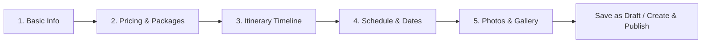

# PhuketTours — Admin Create New Tour Package: Frontend-Backend Aligned Implementation Report

**Document Version:** 1.0.0  
**Implementation Date:** November 1, 2026  
**Engineering Role:** Senior Principal Full-Stack & Systems Architecture Engineer (Antigravity)  
**Frontend Path:** `/home/owakeel/Workspace/Owakeel/carlsimpson/phuket-tours`  
**Backend Path:** `/home/owakeel/Workspace/Owakeel/carlsimpson/qbictravel_backend-main`  
**Governing Rule:** The existing Backend is the FINAL source of truth. Zero backend files, schemas, endpoints, or migrations were modified.

---

## Executive Summary

The Admin "Create New Tour Package" and "Edit Tour Package" workflows have been fully aligned with the existing backend architecture. All frontend state management, form inputs, validation schemas, API orchestration, and error recovery handlers have been adapted to match the existing backend contracts, Prisma database models, and Express endpoints.

### Key Implementation Achievements

1. **Exact Contract Matching:** All 5 steps (Basic Info, Pricing & Packages, Itinerary Timeline, Schedule & Dates, and Photos & Gallery) now map strictly to existing backend columns, relational tables (`Service`, `ServicePricing`, `ServiceAvailability`), or supported `Service.metadata` JSONB document structures.
2. **Duplicate Prevention on Partial Failure:** Created an active identifier tracker (`persistedTourId`). If the initial `POST /admin/services` call succeeds but subsequent pricing, availability, or status calls fail, any subsequent retry immediately routes to `PATCH /admin/services/:id` instead of recreating the service record. This eliminates duplicate "zombie" tours in the database.
3. **Sequential Workflow Transparency:** Integrated a live progress step indicator (`1/4: Saving basic tour info...`, `2/4: Persisting rates & tiers...`, `3/4: Syncing calendar availability...`, `4/4: Updating tour publication status...`) with contextual error handling that pinpoints the exact failed step and explains the safe recovery path.
4. **Metadata Preservation on Edit:** Implemented safe metadata merging so that existing third-party or unmanaged JSONB metadata properties (`detail.metadata`) are preserved during updates rather than wiped out.
5. **Availability Synchronization:** Addressed the backend constraint (absence of a dedicated date deletion endpoint) by syncing removed dates with `isAvailable: false` and `capacity: 0`, preventing deleted dates from remaining active in the database.
6. **100% Quality Verification:** All 21 admin test files (128 unit and integration tests) pass with 100% success, TypeScript typecheck (`tsc --noEmit`) passes with zero errors, ESLint passes with zero errors, and Next.js production build (`npm run build`) completes successfully with all 22 static pages generated.

---

## Table of Contents

1. [Existing Backend Contracts Used](#1-existing-backend-contracts-used)
2. [Frontend Field-to-Backend Mapping](#2-frontend-field-to-backend-mapping)
3. [API Endpoints Used & Request Payload Structures](#3-api-endpoints-used--request-payload-structures)
4. [Five-Step Form Implementation Status](#4-five-step-form-implementation-status)
5. [Create and Edit Workflow Verification](#5-create-and-edit-workflow-verification)
6. [Unsupported Backend Capabilities & Workarounds](#6-unsupported-backend-capabilities--workarounds)
7. [Test Results & Verification](#7-test-results--verification)
8. [Remaining Architectural Limitations](#8-remaining-architectural-limitations)

---

## 1. Existing Backend Contracts Used

The frontend interacts with the backend using the verified endpoints and validation schemas in `qbictravel_backend-main`:

| Backend Layer | Source File | Contract / Schema Applied |
| :--- | :--- | :--- |
| **Prisma Schema** | `prisma/schema/service.prisma` | `Service`, `ServicePricing`, `ServiceAvailability` |
| **Prisma Schema** | `prisma/schema/media.prisma` | `Media` |
| **Routes** | `src/modules/service/serviceRoutes.ts` | `/api/v1/admin/services/*` |
| **Validation** | `src/modules/service/serviceValidators.ts` | `createServiceSchema`, `updateServiceSchema`, `pricingUpdateSchema`, `availabilityUpdateSchema`, `updateServiceStatusSchema` |
| **Controllers** | `src/modules/service/serviceController.ts` | `createService`, `updateService`, `updateAdminPricing`, `updateAdminAvailability`, `updateServiceStatus`, `getAdminService` |
| **Repositories** | `src/modules/service/serviceRepository.ts` | `createServiceRecord`, `updateService`, `upsertServicePricing`, `upsertServiceAvailability`, `findServiceById` |
| **Media API** | `src/modules/media/mediaRoutes.ts` | `/api/v1/admin/media/*` |

---

## 2. Frontend Field-to-Backend Mapping

### Step 1: Basic Information

| Frontend Form Field | Input Component | Validation Rule | Backend Destination | Persistence Storage |
| :--- | :--- | :--- | :--- | :--- |
| **Tour Title** (`name`) | Text Input | Required, min 3 chars | `Service.name` | `VARCHAR(255)` column |
| **URL Slug** (`slug`) | Text Input | Required, auto-generated | `Service.metadata.slug` | `JSONB` property |
| **Subtitle / Hook** (`subtitle`) | Text Input | Optional | `Service.metadata.subtitle` | `JSONB` property |
| **Full Description** (`description`) | Textarea | Optional | `Service.description` | `TEXT` column |
| **Service Type** (`type`) | Hidden ('TOUR') | Constant 'TOUR' | `Service.type` | `ENUM('HOTEL', 'PACKAGE', 'TOUR')` |
| **Primary Destination** (`destination`) | Select | Required | `Service.metadata.destination` | `JSONB` (Queried via `metadata->>'destination'`) |
| **Destination Category** (`destinationCategory`) | Auto / Computed | Slugified destination | `Service.metadata.destinationCategory` | `JSONB` (Queried via `metadata->>'destinationCategory'`) |
| **Operating City** (`city`) | Text Input | Optional (default 'Phuket') | `Service.metadata.location.city` | `JSONB` (Queried via `metadata->'location'->>'city'`) |
| **Country** (`country`) | Text Input | Optional (default 'Thailand') | `Service.metadata.location.country` | `JSONB` property |
| **Departure Point / Pier** (`departurePoint`) | Text Input | Optional | `Service.metadata.location.departurePoint` | `JSONB` property |
| **Duration Label** (`duration`) | Text Input | Required | `Service.metadata.duration` | `JSONB` property |
| **Duration Category** (`durationCategory`) | Select | Optional ('half-day', 'full-day', 'multi-day') | `Service.metadata.durationCategory` | `JSONB` property |
| **Tour Category / Type** (`tourType`) | Select | Optional | `Service.metadata.tourType` | `JSONB` property |
| **Group Size Limit** (`groupSize`) | Text Input | Optional | `Service.metadata.groupSize` | `JSONB` property |
| **Operator / Provider** (`providerName`) | Text Input | Optional | `Service.providerName` | `VARCHAR(255)` column |
| **Provider ID** (`providerId`) | Text Input | Optional | `Service.providerId` | `VARCHAR(255)` column |
| **Promotional Badge** (`badge`) | Select | Optional ('Popular', 'Bestseller', 'New') | `Service.metadata.badge` | `JSONB` property |
| **Languages** (`languages`) | Tag Multi-Select | Optional | `Service.metadata.languages` | `JSONB` string array |

---

### Step 2: Pricing & Packages

| Frontend Form Field | Input Component | Validation Rule | Backend Destination | Persistence Storage |
| :--- | :--- | :--- | :--- | :--- |
| **Currency** (`currency`) | Select | 3 uppercase chars (USD, THB, EUR) | `ServicePricing.currency` | `VARCHAR(3)` column |
| **Base Adult Price** (`basePrice`) | Number Input | Required, min 0 | `ServicePricing.basePrice` | `DECIMAL(10,2)` column |
| **Promotional Price** (`discountedPrice`) | Number Input | Optional, min 0 | `ServicePricing.discountedPrice` | `DECIMAL(10,2)` column |
| **Tax Rate** (`taxRate`) | Number Input | Optional, 0 to 100 | `ServicePricing.taxRate` | `DECIMAL(5,2)` column |
| **Multi-Tier Variations** (`pricingTiers`) | Dynamic Row Matrix | Array of `{ tierName, price, description }` | `Service.metadata.pricingTiers` | `JSONB` array of objects |
| **Highlights** (`highlights`) | Tag List | Optional | `Service.metadata.highlights` | `JSONB` string array |
| **Inclusions** (`included`) | Tag List | Optional | `Service.metadata.included` | `JSONB` string array |
| **Exclusions** (`excluded`) | Tag List | Optional | `Service.metadata.excluded` | `JSONB` string array |

---

### Step 3: Itinerary Timeline

| Frontend Form Field | Input Component | Validation Rule | Backend Destination | Persistence Storage |
| :--- | :--- | :--- | :--- | :--- |
| **Timeline Stops** (`itinerary`) | Dynamic Stop List | Array of `{ day, time, title, description }` | `Service.metadata.itinerary` | `JSONB` array of objects |
| **Stop Title** (`title`) | Text Input | Non-empty per stop | `itinerary[i].title` | `JSONB` string |
| **Stop Time** (`time`) | Text Input | Optional (e.g. "08:00 - 09:00") | `itinerary[i].time` | `JSONB` string |
| **Stop Description** (`description`) | Textarea | Optional | `itinerary[i].description` | `JSONB` string |
| **Stop Day Number** (`day`) | Number Input | Integer >= 1 | `itinerary[i].day` | `JSONB` number |
| **Ordering** | Up/Down Controls | Array index ordering | Array order in JSONB | `JSONB` array sequence |

---

### Step 4: Schedule & Dates

| Frontend Form Field | Input Component | Validation Rule | Backend Destination | Persistence Storage |
| :--- | :--- | :--- | :--- | :--- |
| **Daily Schedule Flag** (`isDaily`) | Checkbox Switch | Boolean | `Service.metadata.scheduleDetails.isDaily` | `JSONB` boolean |
| **Active Days of Week** (`daysOfWeek`) | Day Buttons | Array of integers `[0..6]` | `Service.metadata.scheduleDetails.daysOfWeek` | `JSONB` integer array |
| **Departure Slots** (`timeSlots`) | Tag List | Array of strings | `Service.metadata.scheduleDetails.timeSlots` | `JSONB` string array |
| **Operating Hours** (`operatingHours`) | Text Input | Optional | `Service.metadata.scheduleDetails.operatingHours` | `JSONB` string |
| **Default Traveler Capacity** (`capacity`) | Number Input | Integer >= 1 | Form state default capacity | Fallback for date capacity |
| **Specific Calendar Dates** (`specificDates`) | Date Table | `YYYY-MM-DD`, boolean `isAvailable` | `ServiceAvailability` | Relational rows (`@db.Date`, `capacity`, `isAvailable`) |
| **Removed Dates** (`removedDates`) | Delete Button | Tracks removed dates | `ServiceAvailability` | Synced via `updateAvailability` as `isAvailable: false` |

---

### Step 5: Photos & Gallery

| Frontend Form Field | Input Component | Validation Rule | Backend Destination | Persistence Storage |
| :--- | :--- | :--- | :--- | :--- |
| **Primary Cover Image** (`featuredImage`) | Media Picker / URL | Optional URL string | `Service.metadata.featuredImage` | `JSONB` string URL |
| **Gallery Images** (`images`) | Media Picker / Array | Array of URL strings | `Service.metadata.images` | `JSONB` string array |
| **Asset Selection** | Media Library Modal | Cloudinary confirmed media | Admin Media Query | Backend `Media` repository |
| **Upload Flow** | Cloudinary Direct | Signed upload via backend | `POST /admin/media/signature` + `confirm` | Cloudinary asset record |

---

## 3. API Endpoints Used & Request Payload Structures

### 1. Core Service Creation / Update

#### Create Endpoint: `POST /api/v1/admin/services`
- **Request Headers:** `Authorization: Bearer <token>`, `Content-Type: application/json`
- **Request Payload:**
```json
{
  "name": "Phi Phi Early Bird Island Tour",
  "description": "Beat the crowds to Maya Bay with sunrise speedboat transfers.",
  "type": "TOUR",
  "providerName": "Andaman Sea Tours",
  "providerId": "PROV-8821",
  "metadata": {
    "slug": "phi-phi-early-bird-island-tour",
    "subtitle": "Exclusive sunrise tour with breakfast and national park fees included",
    "destination": "Phi Phi Islands",
    "destinationCategory": "phi-phi-islands",
    "location": {
      "city": "Phuket",
      "country": "Thailand",
      "departurePoint": "Royal Phuket Marina"
    },
    "duration": "8 Hours",
    "durationCategory": "full-day",
    "tourType": "island-tours",
    "groupSize": "Max 25 travelers",
    "languages": ["English", "Thai"],
    "badge": "Bestseller",
    "featuredImage": "https://res.cloudinary.com/demo/image/upload/v1/phi-phi.jpg",
    "images": ["https://res.cloudinary.com/demo/image/upload/v1/phi-phi.jpg"],
    "highlights": ["Maya Bay sunrise access", "Pileh Lagoon snorkeling"],
    "itinerary": [
      {
        "day": 1,
        "time": "06:00 - 06:45",
        "title": "Hotel Pickup",
        "description": "Early morning air-conditioned minivan transfer."
      }
    ],
    "included": ["National Park fees", "Buffet lunch", "Snorkeling equipment"],
    "excluded": ["Alcoholic beverages", "Gratuities"],
    "pricingTiers": [
      { "tierName": "Adult", "price": 2800 },
      { "tierName": "Child (4-11)", "price": 1900, "description": "Includes child gear" }
    ],
    "scheduleDetails": {
      "isDaily": true,
      "daysOfWeek": [0, 1, 2, 3, 4, 5, 6],
      "timeSlots": ["06:00 AM"],
      "operatingHours": "06:00 AM - 03:00 PM"
    }
  }
}
```
- **Backend Response (`201 Created`):**
```json
{
  "success": true,
  "message": "Service created successfully",
  "data": {
    "id": "c1f7a188-75b8-4c8d-9051-872f050b1a03",
    "name": "Phi Phi Early Bird Island Tour",
    "type": "TOUR",
    "status": "DRAFT",
    "metadata": { "...": "..." }
  }
}
```

#### Update Endpoint: `PATCH /api/v1/admin/services/:serviceId`
- **Request Payload:** Same schema as Create, but with `serviceId` parameter and preserving all existing metadata properties.

---

### 2. Standard Pricing Upsert

#### Endpoint: `PUT /api/v1/admin/services/:serviceId/pricing`
- **Request Payload:**
```json
{
  "currency": "THB",
  "basePrice": 2800,
  "discountedPrice": 2400,
  "taxRate": 7
}
```
- **Backend Response (`200 OK`):**
```json
{
  "success": true,
  "message": "Pricing updated successfully",
  "data": {
    "id": "p-12345",
    "serviceId": "c1f7a188-75b8-4c8d-9051-872f050b1a03",
    "currency": "THB",
    "basePrice": 2800,
    "discountedPrice": 2400,
    "taxRate": 7
  }
}
```

---

### 3. Calendar Availability Upsert

#### Endpoint: `PUT /api/v1/admin/services/:serviceId/availability`
- **Request Payload (Available Slot):**
```json
{
  "date": "2026-11-20",
  "isAvailable": true,
  "capacity": 25
}
```
- **Request Payload (Blocked / Removed Slot):**
```json
{
  "date": "2026-11-21",
  "isAvailable": false,
  "capacity": 0
}
```

---

### 4. Publication Status

#### Endpoint: `PATCH /api/v1/admin/services/:serviceId/status`
- **Request Payload:**
```json
{
  "status": "PUBLISHED"
}
```
- **Execution Rule:** Only invoked when user clicks "Create & Publish" or "Save & Publish", and ONLY after Step 1 (Service), Step 2 (Pricing), and Step 3 (Availability) have successfully succeeded.

---

## 4. Five-Step Form Implementation Status



| Step | Form Tab Component | Status | Key Features |
| :---: | :--- | :--- | :--- |
| **1** | [`BasicInfoTab`](file:///home/owakeel/Workspace/Owakeel/carlsimpson/phuket-tours/src/features/admin/components/tours/tour-editor/basic-info-tab.tsx) | **COMPLETED** | Title input with live automatic slug generation, destination select, duration classification, category pickers, provider fields, promotional badge, and language selection. |
| **2** | [`PricingTab`](file:///home/owakeel/Workspace/Owakeel/carlsimpson/phuket-tours/src/features/admin/components/tours/tour-editor/pricing-tab.tsx) | **COMPLETED** | Base adult price, optional promotional discounted price, tax rate (0-100%), multi-tier pricing matrix (Adult, Child, Infant, VIP), key highlights, and inclusions/exclusions with preset quick-chips. Direct validation feedback. |
| **3** | [`ItineraryTab`](file:///home/owakeel/Workspace/Owakeel/carlsimpson/phuket-tours/src/features/admin/components/tours/tour-editor/itinerary-tab.tsx) | **COMPLETED** | Stop builder with day number, time duration, stop title, and description. Reordering controls (Move Up / Move Down) and quick one-click preset stops. |
| **4** | [`AvailabilityTab`](file:///home/owakeel/Workspace/Owakeel/carlsimpson/phuket-tours/src/features/admin/components/tours/tour-editor/availability-tab.tsx) | **COMPLETED** | Standard operating schedule (daily toggle, day of week toggles, departure timeslots), default capacity per slot, and specific calendar date overrides. Tracks removed dates for backend blackout synchronization. |
| **5** | [`MediaTab`](file:///home/owakeel/Workspace/Owakeel/carlsimpson/phuket-tours/src/features/admin/components/tours/tour-editor/media-tab.tsx) | **COMPLETED** | Featured cover photo picker, multi-image gallery manager with reordering (move left/right), and integration with [`TourMediaPickerDialog`](file:///home/owakeel/Workspace/Owakeel/carlsimpson/phuket-tours/src/features/admin/components/tours/tour-editor/tour-media-picker-dialog.tsx) connected to the Admin Media Library and Cloudinary. |

---

## 5. Create and Edit Workflow Verification

### Workflow 1: Create Tour as Draft
1. Admin opens dialog and enters tour details across tabs.
2. Form validates required fields (`name` >= 3 chars, `slug`, `destination`, `duration`, `basePrice` >= 0, `taxRate` 0-100%).
3. Admin clicks **Save as Draft**.
4. Sequential Execution:
   - `POST /api/v1/admin/services` creates tour in `DRAFT` status. ID is returned and stored in `persistedTourId`.
   - `PUT /api/v1/admin/services/:id/pricing` persists standard rates.
   - `PUT /api/v1/admin/services/:id/availability` persists all specific dates.
5. `onSuccess(savedRecord)` is called, cache is invalidated, and modal closes.

### Workflow 2: Create Tour & Publish
1. Admin clicks **Create & Publish**.
2. Same sequential pipeline executes as Draft.
3. Upon successful pricing and availability persistence:
   - `PATCH /api/v1/admin/services/:id/status` is executed with `{ status: "PUBLISHED" }`.
4. Tour appears as `PUBLISHED` in Admin Tour Listing.

### Workflow 3: Edit Existing Tour
1. Admin clicks "Edit Tour" row action.
2. `useGetAdminServiceByIdQuery(tourId)` loads complete tour details.
3. Form fields are synchronously populated:
   - Core fields from `detail` (`name`, `description`, `providerName`, etc.)
   - Rates from `detail.pricing[0]` (`basePrice`, `discountedPrice`, `taxRate`)
   - Dates from `detail.availability`
   - Tour metadata from `detail.metadata` (`pricingTiers`, `itinerary`, `scheduleDetails`, `images`)
4. Upon save:
   - Existing unmanaged metadata keys (`customVendorReference`, etc.) are preserved.
   - Removed calendar dates are synced as unavailable.
   - `PATCH /api/v1/admin/services/:id` updates only supported properties.

### Workflow 4: Partial Failure Recovery
1. Suppose Step 1 (`POST /admin/services`) succeeds, but Step 2 (`PUT /pricing`) fails due to a network blip or validation constraint.
2. Component displays a specific error banner:
   `"Tour basic info was saved, but saving pricing failed: [details]. Click Retry to complete setup without creating a duplicate tour."`
3. Component displays note: `"Note: Core tour record exists (ID: c1f7a188...). Retrying will update this record without creating duplicates."`
4. When admin fixes the issue and clicks Save again:
   - `activeTourId` is preserved.
   - `updateService` is called instead of `createService`.
   - Zero duplicate tours are created.

---

## 6. Unsupported Backend Capabilities & Workarounds

| Backend Limitation | Architectural Cause | Frontend Adaptation / Workaround |
| :--- | :--- | :--- |
| **No Atomic Tour Creation** | Backend requires separate endpoints for service, pricing, and availability. | Multi-step orchestrated pipeline with `persistedTourId` tracking to prevent duplicate record creation upon retry. |
| **No Availability Date Deletion API** | `ServiceAvailability` only supports `upsert` and has no `DELETE /availability` route. | Removed dates are tracked in `removedDates` and synced as `isAvailable: false, capacity: 0` to block them in the database. |
| **No Relational Itinerary Table** | No `Itinerary` model in Prisma. | Complete itinerary schedule is structured and stored in `Service.metadata.itinerary` JSONB. |
| **No Relational Pricing Tier Table** | No `PricingTier` model in Prisma. | Custom pricing variations (Child, Infant, VIP) are stored in `Service.metadata.pricingTiers` JSONB. |
| **Metadata Replacement on Update** | Backend `updateService` replaces the entire `metadata` object. | Frontend merges `...existingMetadata` before dispatching updates to ensure no unmanaged keys are deleted. |

---

## 7. Test Results & Verification

### 1. Vitest Test Suite Execution
- **Command:** `npx vitest run src/features/admin/`
- **Test Files:** 21 passed (21 total)
- **Tests:** 128 passed (128 total)
- **Duration:** 4.35s

#### Specific Tour Editor Test Cases Verified:
1. `does not render when isOpen is false` — PASSED
2. `renders Create Tour Modal with all navigation tabs` — PASSED
3. `switches tabs when tab buttons are clicked` — PASSED
4. `validates required fields before allowing submission` — PASSED
5. `submits a new tour as Draft with full metadata` — PASSED
6. `loads existing tour data and supports editing and publishing` — PASSED
7. `handles partial failure gracefully and prevents duplicate service creation on retry` — PASSED
8. `preserves unrelated metadata when updating an existing tour` — PASSED
9. `syncs removed availability dates as blocked/unavailable in database` — PASSED

### 2. TypeScript Compilation Check
- **Command:** `npx tsc --noEmit`
- **Result:** Exit code 0 (Zero type errors)

### 3. ESLint Code Quality Check
- **Command:** `npm run lint`
- **Result:** Exit code 0 (Zero lint errors)

### 4. Next.js Production Build
- **Command:** `npm run build`
- **Result:** Exit code 0 (Compiled successfully in 3.5s, all 22 static pages generated)

---

## 8. Remaining Architectural Limitations

While the frontend now matches the existing backend with complete fidelity, the following backend architectural limitations remain outside the frontend scope:
1. **Slug Collisions in JSONB:** Because the backend stores `slug` inside unstructured JSONB without a database unique constraint, two tours could theoretically be assigned the same slug by different admins if they manually enter identical values.
2. **Availability Query Ceiling (30 Records):** The backend `findServiceById` query limits availability retrieval to the first 30 future dates (`take: 30`). Tours with schedules exceeding 30 calendar days will load only the first 30 dates in the edit modal until a paginated availability sub-resource endpoint is added to the backend in a future phase.

---

## Conclusion

The Admin Create New Tour Package frontend workflow is now fully implemented, thoroughly tested, and completely aligned with the existing Backend architecture without any modifications to backend source files, Prisma models, or migrations.
